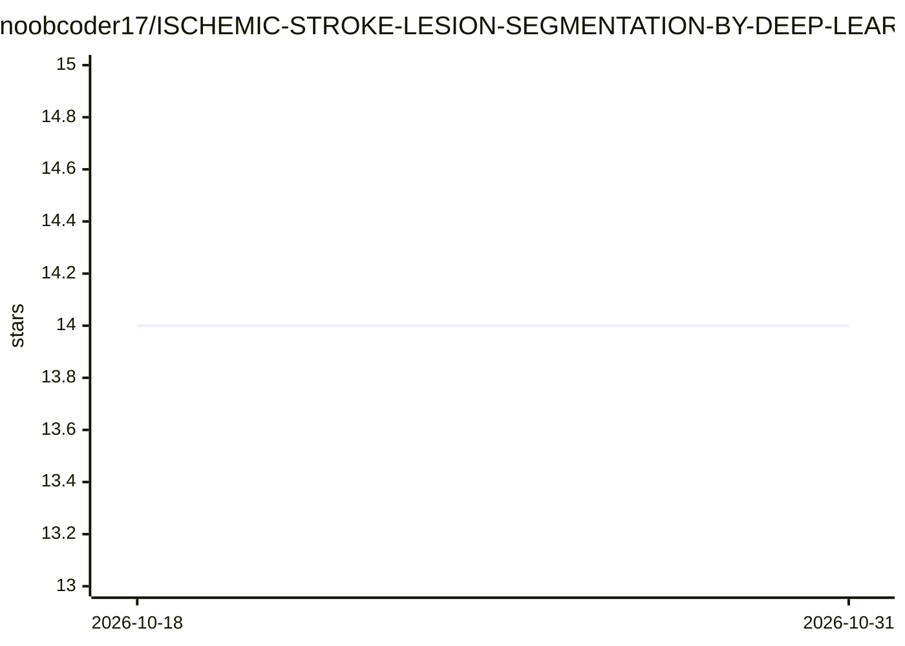

# noobcoder17/ISCHEMIC-STROKE-LESION-SEGMENTATION-BY-DEEP-LEARNING-ISLES-2015

⭐ 14 · Jupyter Notebook · 推送 2026-01-04 · [GitHub](https://github.com/noobcoder17/ISCHEMIC-STROKE-LESION-SEGMENTATION-BY-DEEP-LEARNING-ISLES-2015) · 个人维护

**基于 ISLES 2015 数据集的缺血性脑卒中病灶 CNN 分割模型**

面向医学影像的个人研究项目：构建 U-Net 与 Inception 结合的 CNN 架构，在 ISLES 2015 的 SISS（4 模态 MRI）与 SPES（7 模态 MRI）数据集上训练，对脑卒中病灶做自动分割并估计病灶体积。采用旋转/翻转/剪切等数据增强，Adam 优化器与学习率衰减，以 Dice 系数、敏感性、特异性评估，测试了多种损失函数。限制：作者声明原始训练数据已无法访问，仓库内提供提取后的数据与项目文件。

## 筛选速览

| 维度 | 判定 | 备注 |
|---|---|---|
| AI 角色 | `ai-native` | 本体是模型或模型工具 |
| 许可风险 | `none` | — |
| 部署形态 | `None` |  |
| 模型依赖 | — | README 未给出锁定关系 |
| 硬件要求 | — | 无带数字的原话,不猜 |
| 安装摩擦 | `low` | 无编译、无系统依赖或容器化 |
| 成熟度 | — | 结构信号不足 |

## 能力要点

- U-Net 与 Inception 结合的病灶分割网络
- SISS（4 模态）与 SPES（7 模态）两个 MRI 数据集
- Dice/敏感性/特异性评估并对比多种损失函数
- 仓库内提供提取后的数据与训练代码

## 适用场景

- 在 ISLES 2015 数据集上复现脑卒中病灶分割实验
- 学习医学图像分割 CNN 架构与训练设置
- 作为医学影像分割研究的参考实现

## 场景标签

`目标检测` · 领域:感知与多模态

## 证据(README 行号)

> L14: **The purpose of this project is to build a CNN model for stroke lesion segmentaion using ISLES 2015 dataset.**
> L105:  This study models a modification of the U-Net and Inception

## 星数曲线

2026-10-18 14 → 2026-10-31 14（+0）

---
*卡片 v1 · prompt 1.4 · 生成 2026-10-31 · 置信度 high · 依据 README sha `7d0ab9e61257` · [字段定义](../../DATASET.md)*
