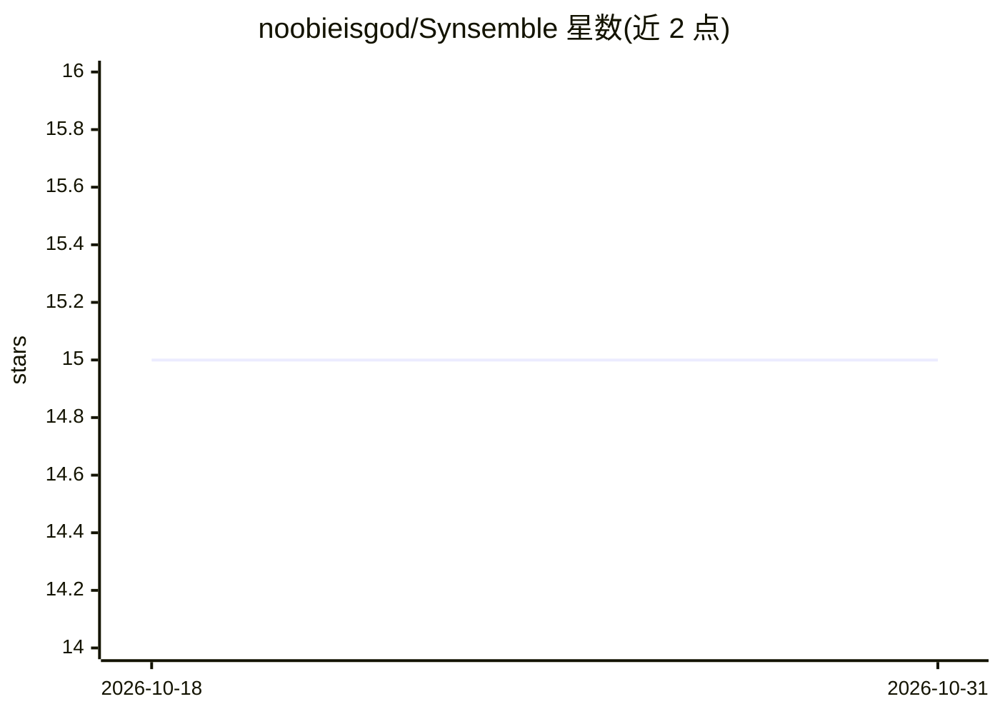

# noobieisgod/Synsemble

⭐ 15 · C++ · MIT · 推送 2026-10-04 · [GitHub](https://github.com/noobieisgod/Synsemble) · [官网](https://noobieisgod.github.io/Synsemble/) · 个人维护

**多 AI 代理协作 Android 应用：多角色共同规划与产出结果**

移动端多智能体协作应用：以“桌子与席位”隐喻为任务配置多个 AI 代理，各自指定提供商、模型与角色，依次经过规划、研究、执行、质量控制与决策阶段，最终产出权威产物。支持 OpenAI、Google Gemini 与 Anthropic 提供商，用户自带 API key，密钥经 Android Keystore 存储。可配置 token/轮次/循环/时长限制，暂停后继续不重放已完成调用。桌面端已停止维护，Android 为唯一发布目标（arm64-v8a，Android 9+）。

## 筛选速览

| 维度 | 判定 | 备注 |
|---|---|---|
| AI 角色 | `ai-native` | 本体是模型或模型工具 |
| 许可风险 | `permissive` | MIT |
| 部署形态 | `None` |  |
| 模型依赖 | — | README 未给出锁定关系 |
| 硬件要求 | — | 无带数字的原话,不猜 |
| 安装摩擦 | `low` | 无编译、无系统依赖或容器化 |
| 成熟度 | — | 结构信号不足 |

## 能力要点

- 多席位多角色代理的结构化规划/执行/审查/决策流程
- OpenAI、Google Gemini、Anthropic 提供商接入
- token/轮次/时长限制与不重放的暂停继续机制
- Android Keystore 存储 API key，不回显凭据内容

## 适用场景

- 为复杂任务组织多个 AI 角色协作产出最终文档
- 对比不同提供商/模型在协作流程中的表现
- 在 Android 设备上通过限额控制多代理会话成本

## 场景标签

`多智能体` · 领域:Agent 开发

## 证据(README 行号)

> L6: Synsemble is a multi-agent AI collaboration app that brings multiple AI roles together to plan, analyze, execute, re
> L10: Synsemble coordinates agents through planning, research where appropriate, execution, quality control, and decision

## 星数曲线

2026-10-18 15 → 2026-10-31 15（+0）

---
*卡片 v1 · prompt 1.4 · 生成 2026-10-30 · 置信度 high · 依据 README sha `e7c37b401cca` · [字段定义](../../DATASET.md)*
