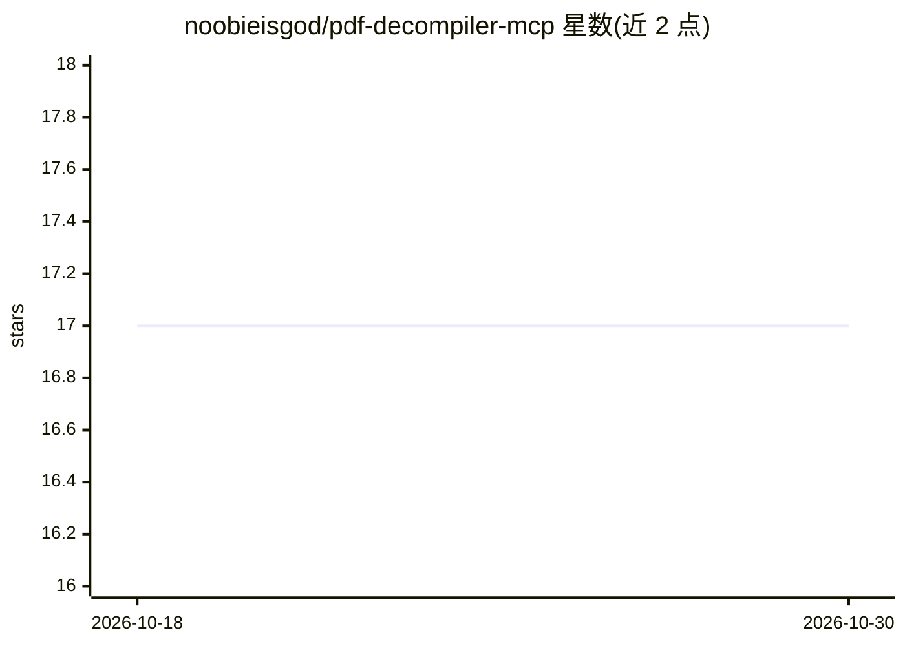

# noobieisgod/pdf-decompiler-mcp

⭐ 17 · JavaScript · AGPL-3.0 · 推送 2026-08-04 · [GitHub](https://github.com/noobieisgod/pdf-decompiler-mcp) · 个人维护

**本地安全优先的 PDF 解析 MCP 服务器：给 AI agent 提供可溯源证据**

面向 MCP 兼容 AI agent 的 PDF 解析服务器，本地运行、无服务端遥测。将 PDF 分解为带引用的文本、表格、图片与页面渲染，通过七个工具按需检索，默认低 token 文本模式，仅在需要时升级到图像。检索支持确定性 BM25、可选语义检索（@huggingface/transformers）与倒数排名融合。文件访问受 --allow-root 显式根目录限制，OCR 依赖可选的 Tesseract。明确要求 Node.js 22/24，仅在 Windows 10/11 直接验证，Apple/Linux 依赖 CI 非阻塞工作流。

## 筛选速览

| 维度 | 判定 | 备注 |
|---|---|---|
| AI 角色 | `ai-ecosystem` | LLM/agent 周边工具 |
| 许可风险 | `viral` | AGPL-3.0 |
| 部署形态 | `library` | 以包/库形式分发 |
| 模型依赖 | — | README 未给出锁定关系 |
| 硬件要求 | — | 无带数字的原话,不猜 |
| 安装摩擦 | `low` | 无编译、无系统依赖或容器化 |
| 成熟度 | — | 结构信号不足 |

## 能力要点

- 七个可组合工具（打开/检索/取页/渲染/关闭等）带结构化引用封套
- 确定性 BM25 检索，可选语义检索与 RRF 融合
- --allow-root 显式访问根与本地缓存，无服务器遥测
- 预算限制、可恢复游标与部分页面分解处理大文档

## 适用场景

- 让 Claude/Codex 等 agent 只检索 PDF 中相关片段而非整文入上下文
- 处理扫描件时按需调用本地 Tesseract OCR
- 对敏感本地 PDF 做受限目录的引用式问答

## 场景标签

`文档解析` `语义搜索` `OCR` · 领域:知识与检索

## 证据(README 行号)

> L7: PDF Decompiler MCP is a security-first, local-first PDF intelligence server for agents. It turns large PDFs into sea
> L55: Use Codex mode for this local STDIO server. Ordinary Chat mode does not expose local STDIO MCP tools. Codex mode in
> L81: Claude Desktop can install the prebuilt MCPB extension without the global npm installation.

## 星数曲线

2026-10-18 17 → 2026-10-30 17（+0）

---
*卡片 v1 · prompt 1.4 · 生成 2026-10-29 · 置信度 high · 依据 README sha `51e10802ba24` · [字段定义](../../DATASET.md)*
