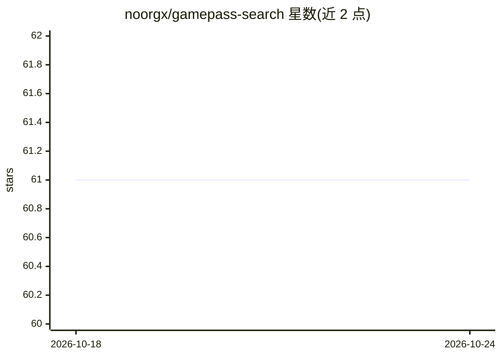

# noorgx/gamepass-search

⭐ 61 · JavaScript · MIT · 推送 2026-07-03 · [GitHub](https://github.com/noorgx/gamepass-search) · 个人维护

**本地浏览筛选 Xbox Game Pass 目录的桌面应用，带设备端 AI 分类**

Electron 桌面应用，从微软官方目录 API 同步全部 Game Pass 游戏到本地 SQLite，支持层级（Essential/Standard/Premium）、平台、发售年份、Metacritic 分数、新进与即将离库等筛选。AI 部分：通过 Transformers.js 在本地 ONNX 运行两个小模型（约 110MB，缓存于 ~/.cache），对游戏做体裁与标签分类，形成四类标签的包含/排除过滤；分类在后台 worker 线程运行，无需云服务与 API key。主要面向 Windows，macOS 未测试；从源码安装运行。

## 筛选速览

| 维度 | 判定 | 备注 |
|---|---|---|
| AI 角色 | `ai-enhanced` | 去掉 AI 部分产品仍成立 |
| 许可风险 | `permissive` | MIT |
| 部署形态 | `library` | 以包/库形式分发 |
| 模型依赖 | — | README 未给出锁定关系 |
| 硬件要求 | — | 无带数字的原话,不猜 |
| 安装摩擦 | `low` | 无编译、无系统依赖或容器化 |
| 成熟度 | — | 结构信号不足 |

## 能力要点

- 设备端 Transformers.js 模型做体裁/标签分类（约 110MB，本地 ONNX）
- 四类 AI 标签（Genre/Themes/Features/Mood）的包含/排除过滤
- 从微软官方目录 API 同步并存储于本地 SQLite
- 分类运行于后台 worker 线程，应用保持响应

## 适用场景

- 在 Game Pass 目录中按标签、层级、评分等条件筛选游戏
- 查看游戏详情、新入库与即将离库信息
- 离线进行游戏体裁分类而不上传数据

## 场景标签

 · 领域:游戏/桌面工具

## 证据(README 行号)

> L3: A local desktop app for browsing, filtering, and exploring the full Xbox Game Pass catalog. Syncs directly from Micr
> L13: Downloads two small AI models the first time you run Enrich Genres (~110 MB total, cached permanently). Classificat
> L45: |Genre classification|Transformers.js (Xenova/nli-deberta-v3-small, local ONNX)|

## 星数曲线

2026-10-18 61 → 2026-10-24 61（+0）

---
*卡片 v1 · prompt 1.4 · 生成 2026-10-24 · 置信度 high · 依据 README sha `a5e8376b228a` · [字段定义](../../DATASET.md)*
