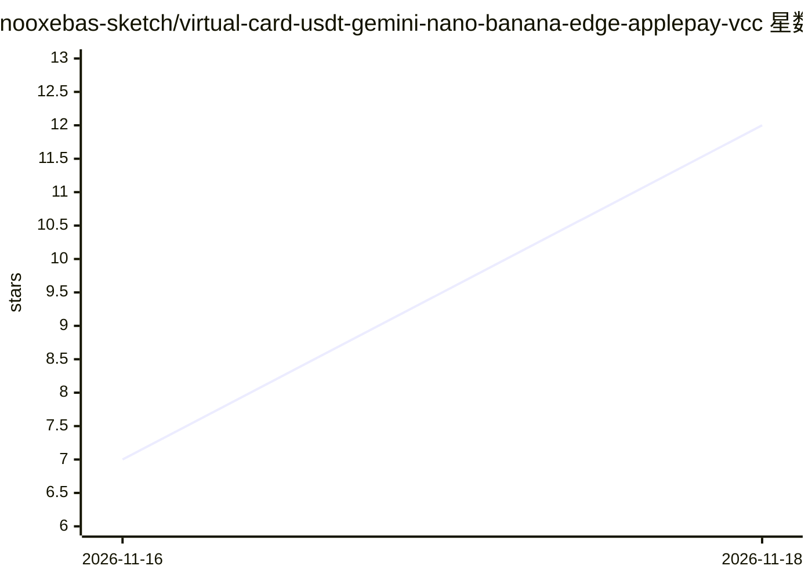

# nooxebas-sketch/virtual-card-usdt-gemini-nano-banana-edge-applepay-vcc

⭐ 12 · 推送 2026-11-16 · [GitHub](https://github.com/nooxebas-sketch/virtual-card-usdt-gemini-nano-banana-edge-applepay-vcc) · [官网](https://app.coregold.io/signup?invite_code=ADvlj9b) · 个人维护 · 中文 README

**面向独立开发者的虚拟卡+USDT+Apple Pay 跨境支付方案推广页**

内容围绕 CoreGold 商业虚拟卡（VCC）的开卡与使用流程：用 USDT（TRC20/ERC20）入金，签发美国商业卡段并附 AVS 地址，用于绑定美区 Apple ID 支付开发者年费、加入 Apple Wallet 支付订阅，以及为云端 API 计费后台设置消费硬限额。文中以端云协同 AI 应用开发为叙事背景，实际核心是支付工具的开卡三步流程（入金、开卡、绑定）。文末含开卡控制台入口。

## 筛选速览

| 维度 | 判定 | 备注 |
|---|---|---|
| AI 角色 | `ai-enhanced` | 去掉 AI 部分产品仍成立 |
| 许可风险 | `none` | — |
| 部署形态 | `None` |  |
| 模型依赖 | — | README 未给出锁定关系 |
| 硬件要求 | — | 无带数字的原话,不猜 |
| 安装摩擦 | `low` | 无编译、无系统依赖或容器化 |
| 成熟度 | — | 结构信号不足 |

## 能力要点

- CoreGold 虚拟卡通过 USDT（TRC20/ERC20）充值入金
- 绑定美区 Apple ID / Apple Wallet 支付开发者账号与订阅费用
- 为云端 API 计费后台设置固定硬限额
- 提供分场景开卡与废卡注销退回残额流程

## 适用场景

- 为美区 Apple Developer 账号年费开通支付卡
- 订阅海外 AI/设计类 SaaS 服务
- 为云端 API 计费绑定带硬限额的独立卡片

## 场景标签

 · 领域:金融支付/虚拟卡

## 证据(README 行号)

> L2: 结合本周 Google 发布端侧轻量化模型 Gemini Nano Banana 2.1 的端云协同趋势，解析 iOS / macOS 独立开发者在订阅美区 Apple Developer 账号、测试美区 App Store 内购以
> L9: ### 一、 为什么 CoreGold 商业 VCC 是苹果生态开发者的“天选之卡”？
> L22: ### 二、 独立开发者 3 分钟全栈开卡流

## 星数曲线

2026-11-16 7 → 2026-11-18 12（+5）

---
*卡片 v1 · prompt 1.4 · 生成 2026-11-18 · 置信度 high · 依据 README sha `46fbc8880c7d` · [字段定义](../../DATASET.md)*
