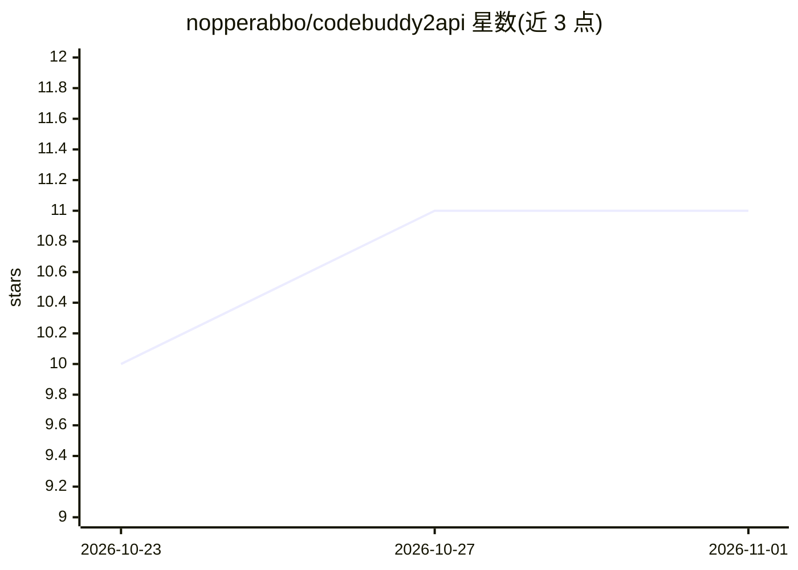

# nopperabbo/codebuddy2api

⭐ 11 · Python · 推送 2026-05-09 · [GitHub](https://github.com/nopperabbo/codebuddy2api) · 个人维护

**将 CodeBuddy/Kiro 的 Claude 等模型转为 OpenAI 兼容 API 的本地代理**

本地运行的 OpenAI 兼容 API 代理服务器，分 Kiro Gateway 与 CodeBuddy 两条通道：用户以 Kiro IDE 账号的 ksk_ API key 经 Kiro 访问 Claude Opus 4.7、Sonnet 4.5、GLM-5、Qwen3、Minimax 等 10 余个模型，并暴露 /v1/chat/completions 等 OpenAI 风格端点。支持多 key 轮换、SSE 流式输出、403/429 错误自动重试换 key。安装为 git clone 源码 + Python 虚拟环境 + pip 依赖，需 Python 3.10+ 与 Kiro IDE 账号；服务器默认监听 8003 端口，所有请求需 Bearer 密码认证，ksk_ key 明文存于 kiro_keys.json（已 gitignore）。

## 筛选速览

| 维度 | 判定 | 备注 |
|---|---|---|
| AI 角色 | `ai-ecosystem` | LLM/agent 周边工具 |
| 许可风险 | `none` | — |
| 部署形态 | `library` | 以包/库形式分发 |
| 模型依赖 | — | README 未给出锁定关系 |
| 硬件要求 | — | 无带数字的原话,不猜 |
| 安装摩擦 | `low` | 无编译、无系统依赖或容器化 |
| 成熟度 | — | 结构信号不足 |

## 能力要点

- Kiro ksk_ key 转换为 OpenAI 兼容 chat/completions 端点
- 多 API key 自动轮换与 403/429 错误自动重试
- SSE 流式响应支持
- 列出 10 余个可用模型（Claude/GLM-5/Qwen3/Minimax 等）

## 适用场景

- 让 Cursor、Continue 等仅支持 OpenAI API 的客户端接入 Kiro 模型
- 在 OpenCode 中配置 kiro/claude-opus-4.7 作为模型
- 用多个 ksk_ key 做轮换以分散请求

## 场景标签

`模型网关` · 领域:Agent 开发

## 证据(README 行号)

> L3: > OpenAI-compatible proxy for **CodeBuddy** and **Kiro (Amazon Q Developer)** — access Claude Opus 4.7, Sonnet 4.5, 
> L98: |`POST`|`/kiro/v1/chat/completions`|Chat completions (OpenAI-compatible)|

## 星数曲线

2026-10-23 10 → 2026-11-01 11（+1）

---
*卡片 v1 · prompt 1.4 · 生成 2026-11-01 · 置信度 mid · 依据 README sha `0a81eb9b5200` · [字段定义](../../DATASET.md)*
