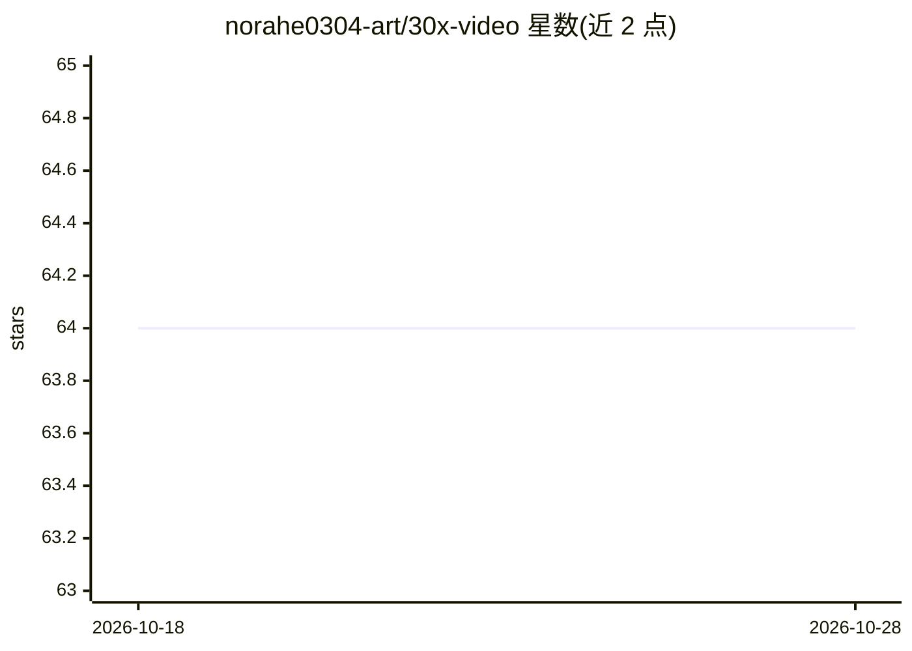

# norahe0304-art/30x-video

⭐ 64 · TypeScript · MIT · 推送 2026-07-09 · [GitHub](https://github.com/norahe0304-art/30x-video) · 个人维护

**输入品牌网址，自动生成 40 秒产品发布视频的 Claude Code 技能**

面向使用 Claude Code 的开发者的视频生成技能：抓取品牌网站的配色、字体、文案、logo 等真实资产，在 16 条设计法则（taste codex）与 4 道证据门控的约束下，用 Remotion + React 设计五幕式 40 秒发布视频，配 ElevenLabs 逐词对齐的 AI 旁白与节拍同步音乐。一次运行约 25 分钟；需 Node 20+ 与 Claude Code 付费计划，macOS/Linux 可用（Windows 未测试）；无 ElevenLabs API key 时回退本地 TTS。

## 筛选速览

| 维度 | 判定 | 备注 |
|---|---|---|
| AI 角色 | `ai-native` | 本体是模型或模型工具 |
| 许可风险 | `permissive` | MIT |
| 部署形态 | `library` | 以包/库形式分发 |
| 模型依赖 | locked-api |  |
| 硬件要求 | — | 无带数字的原话,不猜 |
| 安装摩擦 | `medium` | 含编译或系统依赖之一 |
| 成熟度 | — | 结构信号不足 |

## 能力要点

- 确定性抓取品牌真实资产（配色/字体/文案/logo/产品截图）
- 16 条设计法则 + 4 道证据门控的生成流程
- Remotion + React 渲染，逐词对齐旁白与节拍同步 BGM
- ffmpeg/yt-dlp/playwright 在抓取阶段自动安装

## 适用场景

- 给自己的品牌网站快速生成一支发布视频
- 让 autonomous agent 按规则端到端产出品牌影片
- 作为 Claude Code 技能用户级安装后用自然语言调用

## 场景标签

`视频生成` · 领域:内容生成

## 证据(README 行号)

> L7: A Claude Code skill that turns any brand's website into a 40-second launch video —
> L41: │   HARVEST    │ → │   TASTE CODEX    │ → │   FIVE-ACT FILM          │

## 星数曲线

2026-10-18 64 → 2026-10-28 64（+0）

---
*卡片 v1 · prompt 1.4 · 生成 2026-10-24 · 置信度 high · 依据 README sha `2911192d8c87` · [字段定义](../../DATASET.md)*
