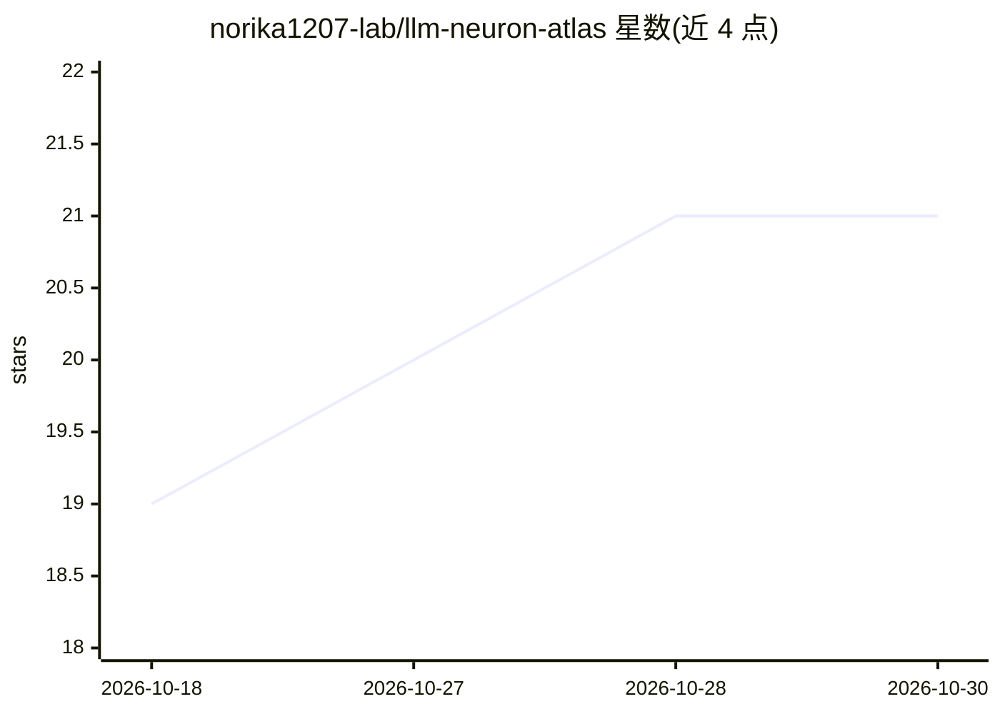

# norika1207-lab/llm-neuron-atlas

⭐ 21 · HTML · MIT · 推送 2026-10-23 · [GitHub](https://github.com/norika1207-lab/llm-neuron-atlas) · 个人维护

**给可解释性研究者：3D 逐神经元探索 transformer 内部结构**

以 3D 可视化形式呈现一个多十亿参数 LLM（默认 Qwen 2.5 3B）的全部神经元：36 层塔状结构、每层 2048 神经元，支持点击查看 top-10 出入连接、追踪同一维度贯穿全层的残差高速路，并与 Phi-3、Mistral 7B 对比跨架构保守性。数据处理为纯 CPU 流程（约 250 行 Python，读取 safetensors 权重输出 117 MB JSON），浏览器端由单 HTML 加载 three.js 渲染。 bake 脚本可适配 Llama/Mistral/Phi-3/GPT-2 等模型族，MoE 尚未支持。

## 筛选速览

| 维度 | 判定 | 备注 |
|---|---|---|
| AI 角色 | `ai-ecosystem` | LLM/agent 周边工具 |
| 许可风险 | `permissive` | MIT |
| 部署形态 | `library` | 以包/库形式分发 |
| 模型依赖 | — | README 未给出锁定关系 |
| 硬件要求 | `cpu-ok` | |
| 安装摩擦 | `low` | 无编译、无系统依赖或容器化 |
| 成熟度 | — | 结构信号不足 |

## 能力要点

- 36 层×2048 神经元的 3D 交互式地图，支持点击与搜索定位
- 点击神经元查看 top-10 出入连接，追踪跨层残差路径
- 纯 CPU bake 流程（约 250 行 Python），无需 GPU
- 与 Phi-3、Mistral 7B 对比跨架构保守维度

## 适用场景

- 在浏览器中逐神经元浏览 LLM 内部结构与信号级联
- 追踪特定维度（如 dim 715、dim 758）跨 36 层的作用路径
- 对比 Qwen 与 Mistral/Phi-3 间保守的锚点维度
- 用 bake 脚本为本地图以外的模型族生成可视化数据

## 场景标签

`科研工具` · 领域:学习与行业

## 证据(README 行号)

> L16: The first 3D explorable visualization of a full multi-billion parameter LLM at the per-neuron level. The mental mod
> L24: Existing LLM viz tools (BertViz, Neuronpedia, SAE feature dashboards, Anthropic circuits) are all 2D and focus on a
> L83: Total output: 117 MB JSON, gzipped to about 35 MB. Pure CPU pipeline (matrix multiplication + np.argpartition), run

## 星数曲线

2026-10-18 19 → 2026-10-30 21（+2）

---
*卡片 v1 · prompt 1.4 · 生成 2026-10-28 · 置信度 high · 依据 README sha `9ce572f73d52` · [字段定义](../../DATASET.md)*
