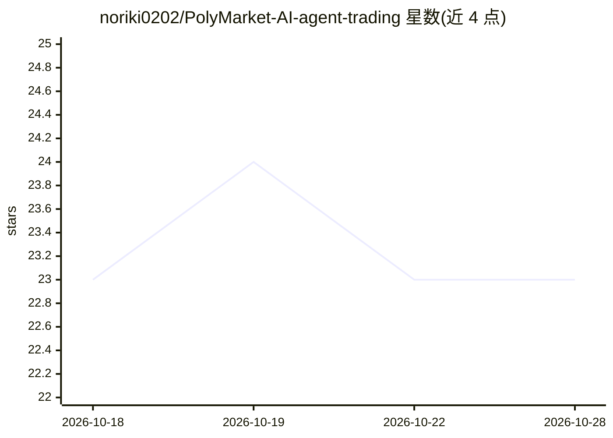

# noriki0202/PolyMarket-AI-agent-trading

⭐ 23 · Python · MIT · 推送 2026-05-11 · [GitHub](https://github.com/noriki0202/PolyMarket-AI-agent-trading) · 个人维护

**构建 Polymarket 预测市场 AI 自主交易 agent 的开发者框架**

面向开发者的 Polymarket 预测市场交易 agent 框架：提供 Polymarket Gamma/DEX API 连接器（市场与事件数据获取、订单构建签名与执行）、本地/远程 RAG 市场分析（Chroma 向量库）、新闻与网络搜索数据源接入，以及基于 LLM 的自主交易 agent 与 CLI。技术栈为 Python 3.12+、LangChain、FastAPI，支持 Docker 容器化部署。交易需配置 Polygon 钱包私钥并充入 USDC，OPENAI_API_KEY 为必需环境变量。

## 筛选速览

| 维度 | 判定 | 备注 |
|---|---|---|
| AI 角色 | `ai-ecosystem` | LLM/agent 周边工具 |
| 许可风险 | `permissive` | MIT |
| 部署形态 | `self-host` | docker 或自建部署 |
| 模型依赖 | — | README 未给出锁定关系 |
| 硬件要求 | — | 无带数字的原话,不猜 |
| 安装摩擦 | `low` | 无编译、无系统依赖或容器化 |
| 成熟度 | — | 结构信号不足 |

## 能力要点

- Polymarket API 集成：市场/事件数据获取与 DEX 订单执行
- 本地与远程 RAG 市场分析，Chroma 向量库可替换实现
- 新闻、网络搜索等数据源接入与 superforecasting 预测方法
- CLI 与 Docker 容器化部署

## 适用场景

- 开发在 Polymarket 上自主交易的 LLM agent
- 检索市场与新闻数据做预测市场分析
- 通过 CLI 查询市场、检索新闻并执行交易

## 场景标签

`Agent 框架` `金融量化` · 领域:Agent 开发

## 证据(README 行号)

> L25: Polymarket Agents is a developer framework and set of utilities for building AI agents for Polymarket.
> L31: - **AI-Powered Trading**: Autonomous trading agents using state-of-the-art LLMs

## 星数曲线

2026-10-18 23 → 2026-10-28 23（+0）

---
*卡片 v1 · prompt 1.4 · 生成 2026-10-27 · 置信度 high · 依据 README sha `4aba77761d34` · [字段定义](../../DATASET.md)*
