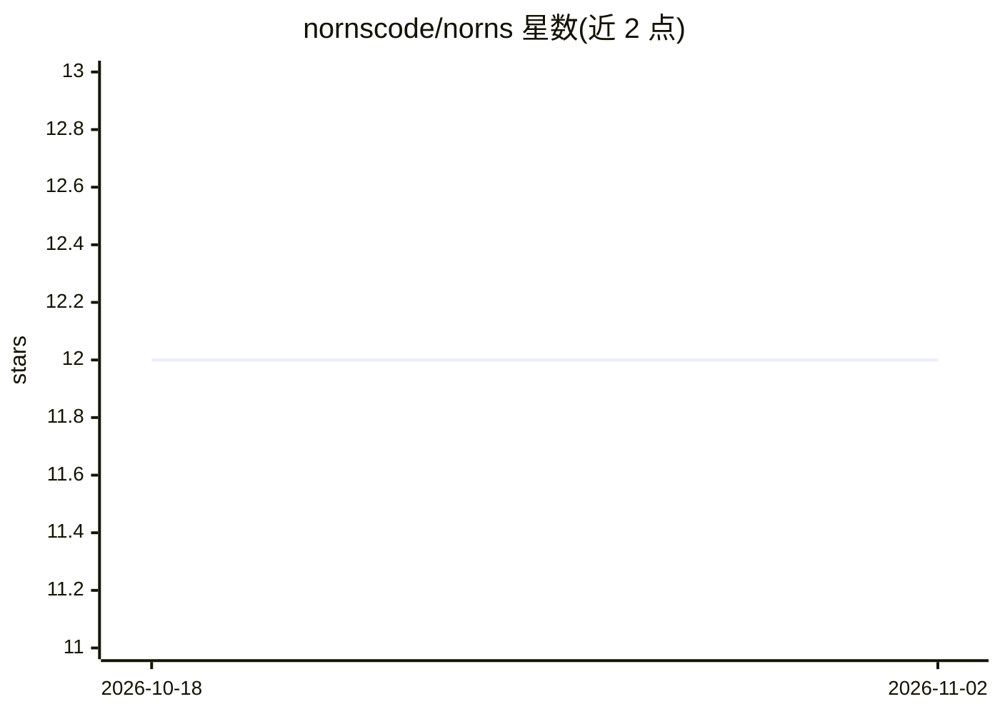

# nornscode/norns

⭐ 12 · Elixir · MIT · 推送 2026-10-27 · [GitHub](https://github.com/nornscode/norns) · [官网](https://nornscode.com) · 个人维护

**长时间运行 Agent 的编排运行时：崩溃/部署不中断**

用 Elixir/BEAM 编写的 Agent 编排器，用于运行需持续数天、独立工作的 agent。运行状态由 Postgres 持久化事件日志支撑而非进程：每次 LLM 调用、工具调用及结果都记录为事件，worker 崩溃或部署后由新 worker 重放日志继续执行，已完成步骤不会重复。编排器自身不调用模型、不运行工具，worker 通过 WebSocket 连接并持有 API key 与工具。提供 Python/Elixir SDK、CLI 及 Slack 机器人和编码 agent 等示例。当前为 v0.x，API 仍在变动。

## 筛选速览

| 维度 | 判定 | 备注 |
|---|---|---|
| AI 角色 | `ai-ecosystem` | LLM/agent 周边工具 |
| 许可风险 | `permissive` | MIT |
| 部署形态 | `library` | 以包/库形式分发 |
| 模型依赖 | — | README 未给出锁定关系 |
| 硬件要求 | — | 无带数字的原话,不猜 |
| 安装摩擦 | `low` | 无编译、无系统依赖或容器化 |
| 成熟度 | `idea` | |

## 能力要点

- 运行状态存于 Postgres 事件日志，崩溃/部署后重放续跑
- 编排器不调用模型，worker 经 WebSocket 注册工具并持有 API key
- 运行可等待人工答复（如 Slack 审批）后再继续
- 提供 Python SDK（PyPI）、Elixir SDK（Hex）与 CLI

## 适用场景

- 运行需要持续数天、跨人工审批节点的自主 agent
- 让 steward 类 agent 读 issue、分派编码 agent 并汇报 PR
- 需要崩溃后从断点恢复的 agent 任务编排

## 场景标签

`Agent 框架` · 领域:Agent 开发

## 证据(README 行号)

> L11: Norns runs agents that are on their own for days at a time. The run is backed by durable storage, not a process, so
> L36: Norns is an orchestrator written in Elixir on the BEAM. It never calls a model and never runs a tool. Workers conne

## 星数曲线

2026-10-18 12 → 2026-11-02 12（+0）

---
*卡片 v1 · prompt 1.4 · 生成 2026-11-01 · 置信度 high · 依据 README sha `c3f6a94de0bd` · [字段定义](../../DATASET.md)*
