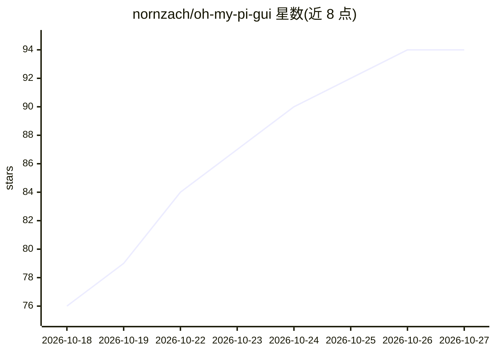

# nornzach/oh-my-pi-gui

⭐ 94 · TypeScript · MIT · 推送 2026-10-26 · [GitHub](https://github.com/nornzach/oh-my-pi-gui) · [官网](https://nornzach.github.io/oh-my-pi-gui/) · 个人维护 · 中文 README

**omp 编码 Agent 的桌面 GUI：并行会话与工具调用可视化管理**

基于 Electron/React 构建的 omp 编码代理桌面客户端，内置 Agent 运行时（安装 DMG/NSIS/便携包后无需单独安装 omp、Bun 或 Node），与 TUI 共享 ~/.omp 配置与会话。提供多标签并行会话（含 Git worktree 隔离）、双窗格分屏、工具调用与 diff 的专用渲染器、终端与内置浏览器视图、Agent Hub、模型/角色分配、OpenAI/Anthropic 兼容端点的 Provider 管理、上下文与成本统计、MCP 管理与本地语音输入。模型请求仍发往用户配置的 Provider，需自行提供凭据。提供 macOS/Windows/Linux 安装包。

## 筛选速览

| 维度 | 判定 | 备注 |
|---|---|---|
| AI 角色 | `ai-native` | 本体是模型或模型工具 |
| 许可风险 | `permissive` | MIT |
| 部署形态 | `desktop` | 安装包/桌面程序 |
| 模型依赖 | — | README 未给出锁定关系 |
| 硬件要求 | — | 无带数字的原话,不猜 |
| 安装摩擦 | `low` | 无编译、无系统依赖或容器化 |
| 成熟度 | — | 结构信号不足 |

## 能力要点

- 内置 Agent 运行时，安装包无需单独安装 omp/Bun/Node
- 多标签并行会话与 Git worktree 隔离、双窗格分屏
- 工具调用（Bash/read/grep/task）专用渲染器与 diff 审查
- 兼容 OpenAI/Anthropic 端点的自定义 Provider 接入

## 适用场景

- 同时跑多个编码 Agent 会话并审查各自的代码改动
- 在桌面端管理 omp 的模型、Provider、MCP 与技能配置
- 查看会话的 token、成本与上下文用量统计

## 场景标签

`编码 Agent` · 领域:编码与开发

## 证据(README 行号)

> L3: **A desktop home for parallel coding agents.**
> L19: Built on omp, this Electron desktop app bundles its own agent: **users of the DMG, NSIS, and portable packages do n
> L44: |**Session library**|Search history, explore session trees, branches and forks, organize labels, copy-import Claude

## 星数曲线

2026-10-18 76 → 2026-10-27 94（+18）

---
*卡片 v1 · prompt 1.4 · 生成 2026-10-23 · 置信度 high · 依据 README sha `0d344a092216` · [字段定义](../../DATASET.md)*
