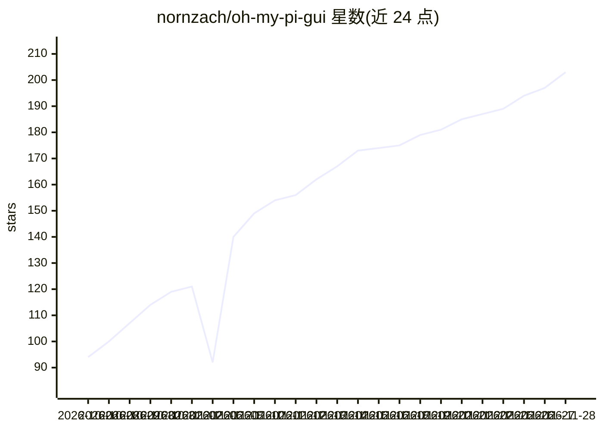

# nornzach/oh-my-pi-gui

⭐ 203 · TypeScript · MIT · 推送 2026-11-27 · [GitHub](https://github.com/nornzach/oh-my-pi-gui) · [官网](https://nornzach.github.io/oh-my-pi-gui/) · 个人维护 · 中文 README

**omp 编码 Agent 的桌面 GUI：并行会话与用量管理**

基于 Electron/React 的 omp 编码 Agent 桌面图形客户端，与 omp TUI 共享 ~/.omp 配置与会话。DMG/NSIS/便携包内置 agent 运行时，无需单独安装 omp、Bun 或 Node。提供多标签并行会话（各自 Git worktree）、分屏对比、工具调用可视化渲染（diff/Bash/Mermaid 等）、内置终端与浏览器视图、模型/提供商管理、角色分配、本地统计与用量看板、MCP 服务器管理、定时任务、SSH 设置与中英文俄界面。会话运行仍需配置模型凭证；worktree 依赖 Git。

## 筛选速览

| 维度 | 判定 | 备注 |
|---|---|---|
| AI 角色 | `ai-ecosystem` | LLM/agent 周边工具 |
| 许可风险 | `permissive` | MIT |
| 部署形态 | `desktop` | 安装包/桌面程序 |
| 模型依赖 | — | README 未给出锁定关系 |
| 硬件要求 | — | 无带数字的原话,不猜 |
| 安装摩擦 | `low` | 无编译、无系统依赖或容器化 |
| 成熟度 | — | 结构信号不足 |

## 能力要点

- 多标签并行会话，各含独立 sidecar 与 Git worktree
- 工具调用可视化：diff、Bash、Mermaid、可折叠思考过程
- 提供商与模型管理，兼容 OpenAI/Anthropic 端点拉取模型列表
- 内置本地统计看板：请求、token、成本、缓存与速度

## 适用场景

- 在图形界面同时运行多个编码 Agent 会话并分屏对比
- 管理多个模型提供商、为角色分配不同模型
- 查看本地 token/成本/缓存统计与提供商用量
- 把请求设为后台定时任务并在 review 队列审阅

## 场景标签

`编码 Agent` · 领域:编码与开发

## 证据(README 行号)

> L3: **A desktop home for parallel coding agents.**
> L19: Built on omp, this Electron desktop app bundles its own agent: **users of the DMG, NSIS, and portable packages do n
> L46: |**Providers**|Sign in, add/edit/remove custom providers, and fetch a model list from compatible OpenAI or Anthropi

## 星数曲线

2026-10-26 94 → 2026-11-28 203（+109）

---
*卡片 v1 · prompt 1.4 · 生成 2026-11-28 · 置信度 high · 依据 README sha `48bb22635fe0` · [字段定义](../../DATASET.md)*
