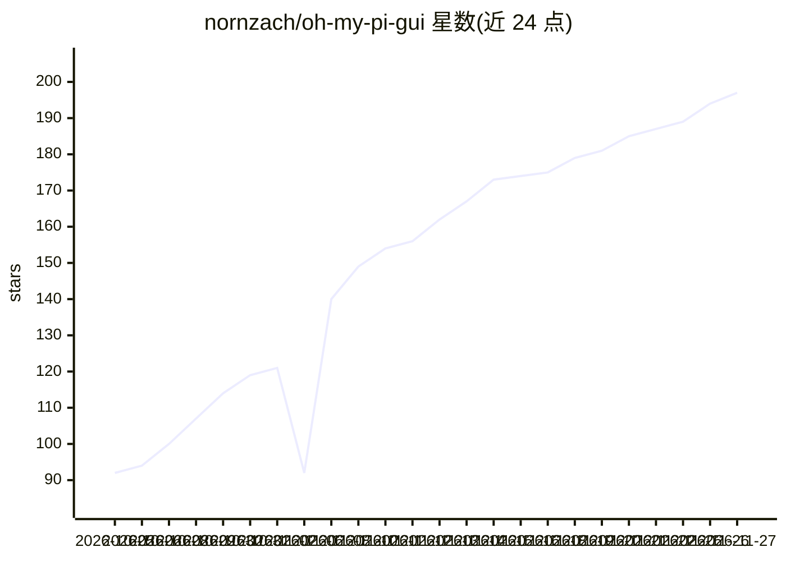

# nornzach/oh-my-pi-gui

⭐ 197 · TypeScript · MIT · 推送 2026-11-26 · [GitHub](https://github.com/nornzach/oh-my-pi-gui) · [官网](https://nornzach.github.io/oh-my-pi-gui/) · 个人维护 · 中文 README

**omp 编码 Agent 的桌面 GUI：并行会话、工具调用可视化管理**

基于 Electron 与 React 的桌面应用，为 omp 编码 Agent 提供图形界面：多标签并行会话（每个标签独立 sidecar 与 Git worktree）、分屏对比、diff 与 Bash/grep 等工具调用的专属渲染、内置终端与可被 Agent 驱动的浏览器视图、模型与 provider 管理、MCP 服务器管理、本地用量统计与成本核算、定时任务与 Agent Hub。DMG/NSIS/便携包内置 Agent 运行时，无需单独安装 omp、Bun 或 Node；与 TUI 共享 ~/.omp 配置与会话。支持中英俄三语与自定义主题。

## 筛选速览

| 维度 | 判定 | 备注 |
|---|---|---|
| AI 角色 | `ai-ecosystem` | LLM/agent 周边工具 |
| 许可风险 | `permissive` | MIT |
| 部署形态 | `desktop` | 安装包/桌面程序 |
| 模型依赖 | — | README 未给出锁定关系 |
| 硬件要求 | — | 无带数字的原话,不猜 |
| 安装摩擦 | `low` | 无编译、无系统依赖或容器化 |
| 成熟度 | — | 结构信号不足 |

## 能力要点

- 多标签并行会话，每个标签独立 sidecar、会话与消息队列
- 内置终端与完整浏览器视图，Agent 工具调用可视可接管
- 从兼容 OpenAI/Anthropic 端点拉取模型列表并管理自定义 provider
- 本地统计面板：请求、token、成本、缓存与速度，实时用量核算

## 适用场景

- 在图形界面同时运行多个编码 Agent 会话并分屏审阅 diff
- 集中管理多个 provider 的模型、凭据与用量配额
- 把重复请求设为定时任务，在后台 Git worktree 中运行并审阅报告
- 通过 relay 与他人共享或托管同一个 Agent 会话

## 场景标签

`编码 Agent` · 领域:编码与开发

## 证据(README 行号)

> L19: Built on omp, this Electron desktop app bundles its own agent: **users of the DMG, NSIS, and portable packages do n
> L46: |**Providers**|Sign in, add/edit/remove custom providers, and fetch a model list from compatible OpenAI or Anthropi

## 星数曲线

2026-10-25 92 → 2026-11-27 197（+105）

---
*卡片 v1 · prompt 1.4 · 生成 2026-11-26 · 置信度 high · 依据 README sha `887a7fbc6d59` · [字段定义](../../DATASET.md)*
