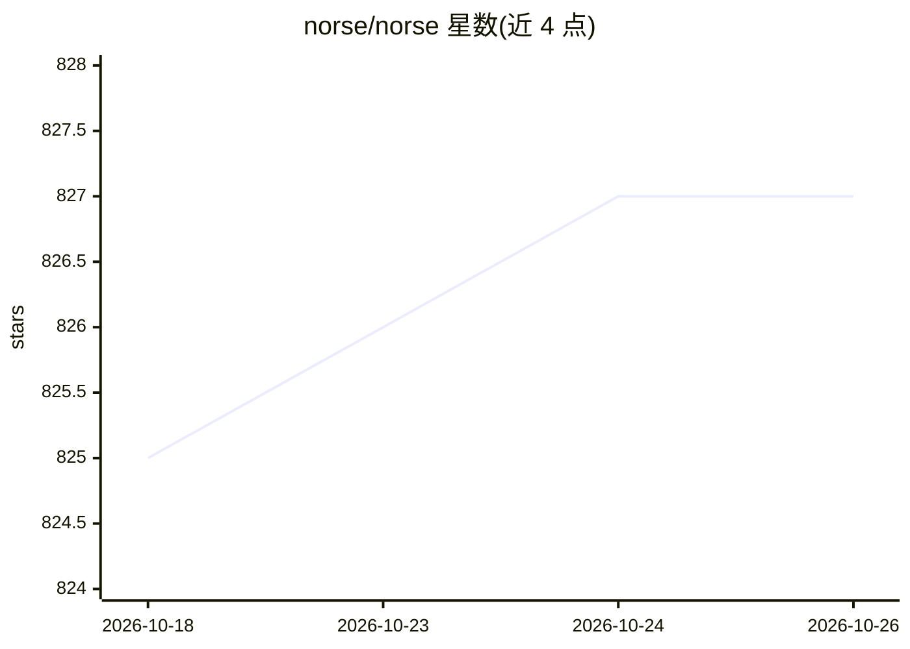

# norse/norse

⭐ 827 · Python · LGPL-3.0 · 推送 2026-07-07 · [GitHub](https://github.com/norse/norse) · [官网](https://norse.github.io/norse/) · 组织维护

**在 PyTorch 中构建脉冲神经网络（SNN）的深度学习库**

Norse 是一个扩展 PyTorch 的脉冲神经网络（SNN）库：提供生物启发式神经元模型（LIF、LSNN 等）、突触动力学、编码/解码算法、数据集集成与示例任务，可直接纳入 PyTorch 工作流训练与推理。面向从事神经形态计算与类脑学习研究的研究者与开发者，支持从笔记本到 HPC 集群的扩展（配合 PyTorch Lightning），README 报告的基准限于每层约 5000 神经元以内的小网络。由海德堡大学与 KTH 的研究人员创建，许可证为 LGPLv3。

## 筛选速览

| 维度 | 判定 | 备注 |
|---|---|---|
| AI 角色 | `ai-native` | 本体是模型或模型工具 |
| 许可风险 | `viral` | LGPL-3.0 |
| 部署形态 | `self-host` | docker 或自建部署 |
| 模型依赖 | — | README 未给出锁定关系 |
| 硬件要求 | — | 无带数字的原话,不猜 |
| 安装摩擦 | `low` | 无编译、无系统依赖或容器化 |
| 成熟度 | — | 结构信号不足 |

## 能力要点

- 提供 LIF、LSNN 等神经元模型与突触动力学原语
- 内置 MNIST、CIFAR10、cartpole 等可运行示例任务
- 兼容 PyTorch Lightning，示例任务支持多 GPU 运行
- 提供 pip、源码、Docker、Conda 四种安装方式

## 适用场景

- 在 PyTorch 基础设施上搭建与训练脉冲神经网络模型
- 复现 LSNN 等脉冲神经网络论文方法
- 在 HPC 集群上扩展运行神经形态实验

## 场景标签

 · 领域:深度学习/神经形态计算

## 证据(README 行号)

> L1: A deep learning library for spiking neural networks.
> L21: Norse expands PyTorch with primitives for bio-inspired neural components,
> L22: bringing you two advantages: a modern and proven infrastructure based on PyTorch and deep learning-compatible spiki

## 星数曲线

2026-10-18 825 → 2026-10-26 827（+2）

---
*卡片 v1 · prompt 1.4 · 生成 2026-10-21 · 置信度 high · 依据 README sha `f89df7926b7f` · [字段定义](../../DATASET.md)*
