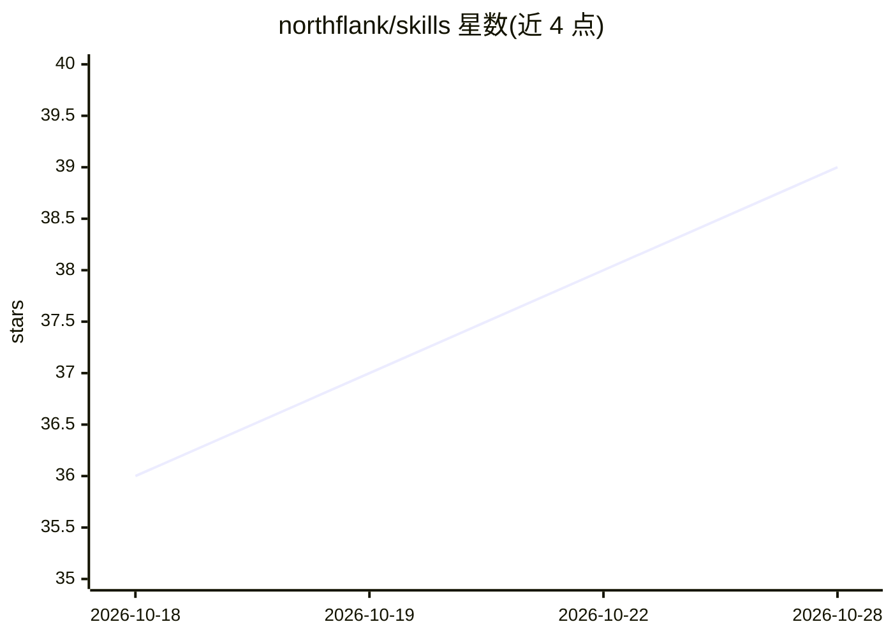

# northflank/skills

⭐ 39 · JavaScript · 推送 2026-10-28 · [GitHub](https://github.com/northflank/skills) · [官网](https://northflank.com) · 组织维护

**供编码 Agent 使用的 Northflank 部署运维技能包**

由 Northflank 官方维护的 agent skill 与插件：为 Claude Code、OpenAI Codex、Cursor、OpenCode、Windsurf 等编码 Agent 提供部署、运维 Northflank 工作负载的指引与参考资料，覆盖服务、Job、addon、预览环境、发布流程、沙箱、GPU 工作负载、域名、密钥、模板、BYOC/BYOK 及 Northflank API/CLI。支持插件市场安装、npx skills 安装或手动复制技能目录；参考文档由 Northflank 的 llms.txt 索引生成并可用脚本刷新。安装技能与连接 Northflank MCP server 是两个独立步骤。

## 筛选速览

| 维度 | 判定 | 备注 |
|---|---|---|
| AI 角色 | `ai-knowledge` | 知识聚合/清单类 |
| 许可风险 | `none` | — |
| 部署形态 | `library` | 以包/库形式分发 |
| 模型依赖 | — | README 未给出锁定关系 |
| 硬件要求 | — | 无带数字的原话,不猜 |
| 安装摩擦 | `low` | 无编译、无系统依赖或容器化 |
| 成熟度 | — | 结构信号不足 |

## 能力要点

- 覆盖 Northflank 服务/Job/addon/预览环境/GPU 工作负载等主题的技能与参考文档
- 支持 Claude Code 插件市场、Codex 插件、npx skills CLI 与手动安装四种途径
- 参考文档从 Northflank llms.txt 索引生成，可用脚本刷新

## 适用场景

- 让编码 Agent 直接执行 Northflank 的部署与资源管理任务
- 为 Agent 提供编写 Northflank 模板、配置 addon 与密钥的指引
- 在多个编辑器/Agent 环境中统一安装同一套 Northflank 技能

## 场景标签

 · 领域:云平台部署/DevOps

## 证据(README 行号)

> L3: An agent skill for deploying, operating, and automating workloads on Northflank. Includes guidance and references fo
> L58: Alternatively, install the Northflank Skill using the Skills CLI, which supports Codex, Claude Code, Cursor, OpenCo

## 星数曲线

2026-10-18 36 → 2026-10-28 39（+3）

---
*卡片 v1 · prompt 1.4 · 生成 2026-10-25 · 置信度 high · 依据 README sha `30ccc8d34ba3` · [字段定义](../../DATASET.md)*
