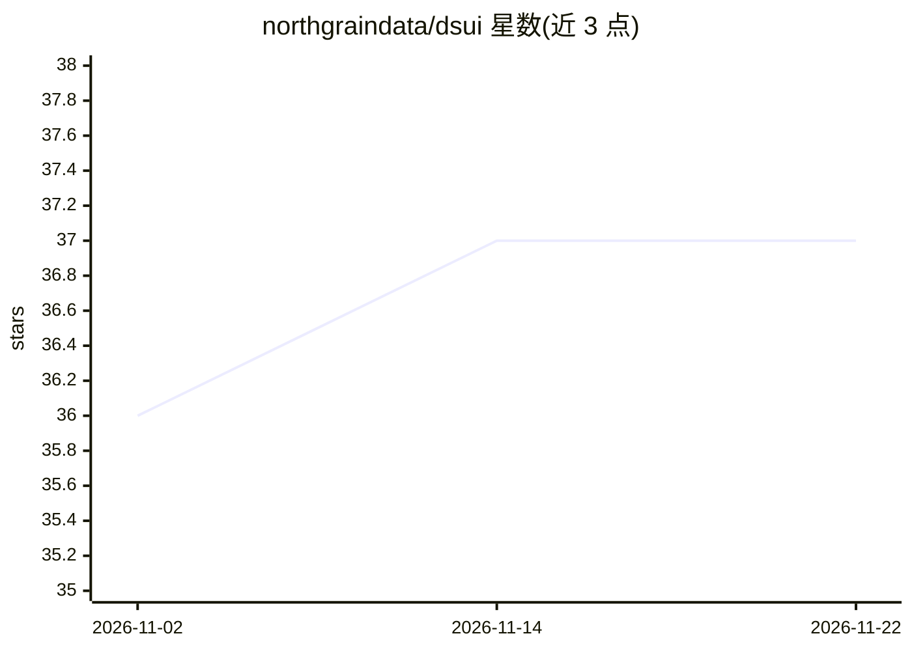

# northgraindata/dsui

⭐ 37 · TypeScript · Apache-2.0 · 推送 2026-11-21 · [GitHub](https://github.com/northgraindata/dsui) · [官网](https://dsui.northgraindata.com) · 组织维护

**自托管的数据栈统一控制平面，内置跨服务 AI 助手**

面向数据工程工作区的自托管控制平面：通过适配器连接 Airflow、dbt、PostgreSQL、ClickHouse、S3/MinIO、DuckDB 等工具，在一个界面里查看失败的 DAG、检查表、运行查询与服务健康状态。内置聊天式 AI 助手，可在一次对话中跨多个已连接服务排查问题，模型提供商可配置。通过 npx 本地运行或 Docker 容器部署，用 TypeScript Adapter/Plugin SDK 扩展自定义集成与页面。另有 DSUI Cloud 托管版。

## 筛选速览

| 维度 | 判定 | 备注 |
|---|---|---|
| AI 角色 | `ai-enhanced` | 去掉 AI 部分产品仍成立 |
| 许可风险 | `permissive` | Apache-2.0 |
| 部署形态 | `self-host` | docker 或自建部署 |
| 模型依赖 | — | README 未给出锁定关系 |
| 硬件要求 | — | 无带数字的原话,不猜 |
| 安装摩擦 | `low` | 无编译、无系统依赖或容器化 |
| 成熟度 | — | 结构信号不足 |

## 能力要点

- 适配器连接 Airflow、dbt、PostgreSQL、ClickHouse、S3/MinIO、DuckDB
- AI 助手可跨多个已连接服务排查问题，模型提供商可配置
- TypeScript Adapter SDK 与 Plugin SDK 支持自定义集成与页面
- 提供 Docker 自托管与 DSUI Cloud 托管两种部署方式

## 适用场景

- 在一个工作区里管理多个数据服务并查看健康状态
- 让 AI 助手跨服务排查失败的 DAG 或 dbt 运行
- 为内部服务构建自定义适配器和插件

## 场景标签

 · 领域:数据工程/运维工具

## 证据(README 行号)

> L7: Connect your data tools and manage them from one place. Explore your infrastructure, run operations, and work across
> L15: Connect tools through adapters, run service operations, and use the AI assistant to work across your connected stac
> L29: The AI assistant is a chat inside the workspace.

## 星数曲线

2026-11-02 36 → 2026-11-22 37（+1）

---
*卡片 v1 · prompt 1.4 · 生成 2026-11-18 · 置信度 high · 依据 README sha `699248bf1be1` · [字段定义](../../DATASET.md)*
