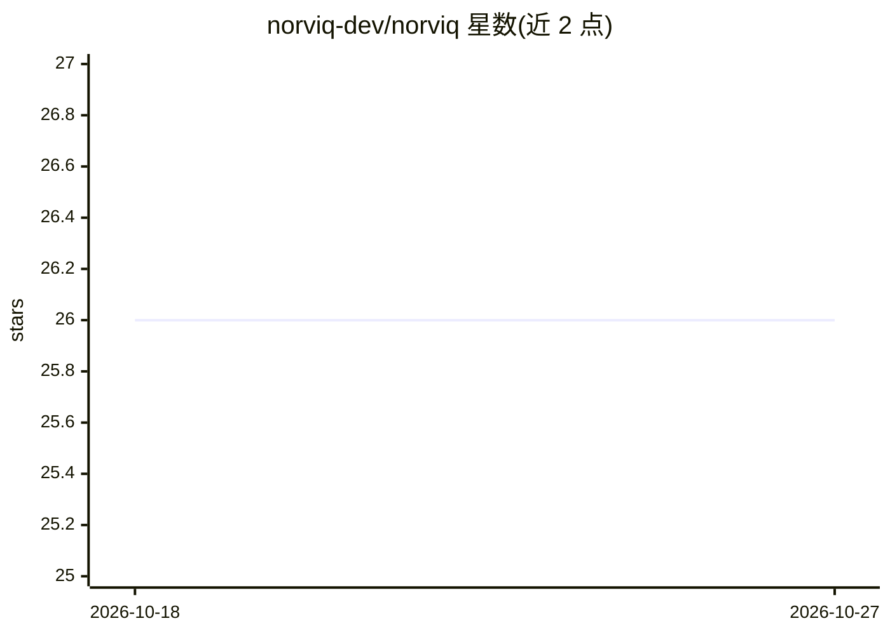

# norviq-dev/norviq

⭐ 26 · Python · Apache-2.0 · 推送 2026-10-01 · [GitHub](https://github.com/norviq-dev/norviq) · [官网](https://norviq.dev) · 组织维护

**Kubernetes 上 LLM agent 工具调用的运行时策略执行点**

部署在 agent 推理循环与其可调用工具之间的策略执行点（PEP）：拦截每次工具调用，按工作负载的 Kubernetes/SPIFFE 身份用 OPA/Rego 分层策略评估，输出 allow/block/escalate/audit 决策。以 mutating webhook 注入 sidecar，或通过 SDK 在 LangChain/LangGraph/CrewAI/AutoGen/Semantic Kernel 进程内拦截。另提供无集群的 MCP stdio 代理模式，仅做扫描与定义变更检测，不做执行。附 Console UI、红队测试套件与 MITRE ATLAS/OWASP LLM 覆盖映射，Helm chart 部署。

## 筛选速览

| 维度 | 判定 | 备注 |
|---|---|---|
| AI 角色 | `ai-ecosystem` | LLM/agent 周边工具 |
| 许可风险 | `permissive` | Apache-2.0 |
| 部署形态 | `self-host` | docker 或自建部署 |
| 模型依赖 | — | README 未给出锁定关系 |
| 硬件要求 | — | 无带数字的原话,不猜 |
| 安装摩擦 | `low` | 无编译、无系统依赖或容器化 |
| 成熟度 | — | 结构信号不足 |

## 能力要点

- 工具调用前 OPA/Rego 评估，按 SPIFFE 身份分层（agent-class→namespace→cluster）且最严格规则生效
- sidecar 零代码改动注入，或 SDK 支持 LangChain/LangGraph/CrewAI/AutoGen/Semantic Kernel
- 无集群本地模式：MCP stdio 代理做注入扫描与工具定义哈希钉扎
- 内置红队套件（提示注入/SQLi/PII 外泄）与 MITRE ATLAS、OWASP LLM Top-10 映射

## 适用场景

- 在 Kubernetes 集群中对 agent 的数据库/shell/邮件等工具调用做策略管控
- 以 audit 模式先行观察再切换到 block 强制执行
- 在笔记本上用 MCP 代理检测工具定义被篡改或注入

## 场景标签

`网络安全` · 领域:学习与行业

## 证据(README 行号)

> L15: Norviq is a policy enforcement point (PEP) that sits between an AI agent's reasoning loop and the
> L16: tools it can call. Every tool call is intercepted, evaluated against OPA/Rego policies scoped to the

## 星数曲线

2026-10-18 26 → 2026-10-27 26（+0）

---
*卡片 v1 · prompt 1.4 · 生成 2026-10-26 · 置信度 mid · 依据 README sha `f2c486a04db9` · [字段定义](../../DATASET.md)*
