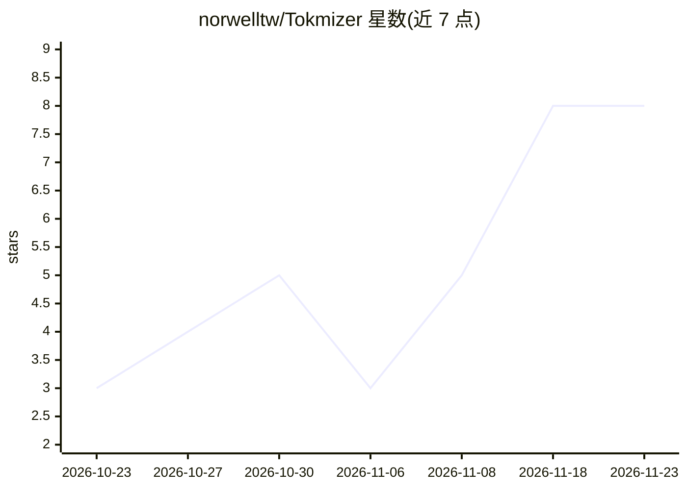

# norwelltw/Tokmizer

⭐ 8 · TypeScript · Apache-2.0 · 推送 2026-11-19 · [GitHub](https://github.com/norwelltw/Tokmizer) · [官网](https://tokmizer.com) · 个人维护 · 中文 README

**为 AI 编码 agent 压缩命令输出 token 的 CLI 中间层**

Tokmizer 以 hook/plugin 形式插入 Claude Code、Codex、Cursor 等 20 余个 AI 编码 agent 与 shell 命令之间：命令经内置规则（cargo/pytest/git/docker 等）路由后，剪除通过测试、进度条、重复行，保留失败、诊断、位置与退出码，完整输出副本留本地可经 tkr restore 取回；同时缩短大文件读取、grep、glob 与图像输入。读取用户的 allow/deny 权限规则，命中则原样执行命令。提供 npm/Homebrew/curl 安装脚本，自动更新，含 token 用量统计与命令纠错规则生成。

## 筛选速览

| 维度 | 判定 | 备注 |
|---|---|---|
| AI 角色 | `ai-ecosystem` | LLM/agent 周边工具 |
| 许可风险 | `permissive` | Apache-2.0 |
| 部署形态 | `library` | 以包/库形式分发 |
| 模型依赖 | — | README 未给出锁定关系 |
| 硬件要求 | — | 无带数字的原话,不猜 |
| 安装摩擦 | `medium` | 含编译或系统依赖之一 |
| 成熟度 | — | 结构信号不足 |

## 能力要点

- 对 20+ AI 编码 agent 提供逐个 setup 命令与 hook/plugin 接入
- 内置 cargo、pytest、git、docker 等规则的输出缩短，完整输出本地留存可恢复
- 读取并尊重各 agent 的 allow/deny 权限规则，设置文件改动均备份
- tkr usage 统计本地日志中的 token 用量；tkr learn 生成命令纠错规则文件

## 适用场景

- AI 编码 agent 跑测试/构建时减少进入上下文窗口的命令输出
- 保留全部失败诊断的同时压缩冗长日志
- 统计各 agent、各模型按天的 token 消耗与开销

## 场景标签

`编码 Agent` · 领域:编码与开发

## 证据(README 行号)

> L13: Every `npm test`, `cargo build`, `git log` or `grep -rn` your agent runs pours its full output into the context win
> L97: |Claude Code|plugin above, or `tkr setup-claude`|native hooks|
> L156: 1. **Before a command runs**, the agent's hook asks Tokmizer whether to route it. If so, it runs through `tkr-exec

## 星数曲线

2026-10-23 3 → 2026-11-23 8（+5）

---
*卡片 v1 · prompt 1.4 · 生成 2026-11-20 · 置信度 high · 依据 README sha `c14c8929da44` · [字段定义](../../DATASET.md)*
