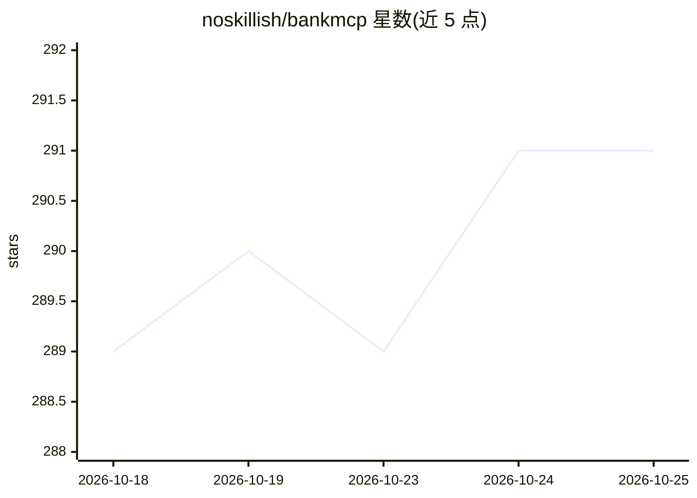

# noskillish/bankmcp

⭐ 292 · TypeScript · MIT · 推送 2026-10-22 · [GitHub](https://github.com/noskillish/bankmcp) · [官网](https://bankmcp.dk/) · 个人维护

**自托管只读 MCP 服务器：让 AI 助手读取你的银行账户**

单用户、只读的开源 MCP 服务器（npm 包 bankmcp），通过 Enable Banking 的 PSD2 API 连接 2,700+ 欧洲银行，把账户余额与交易以 MCP 工具形式暴露给 Claude、ChatGPT、Cursor、Ollama 等客户端。支持本机运行或 Docker/Railway/Fly.io/Render 部署，内含 OAuth 2.1 授权服务器、账户标签、后台余额/交易监控（watches，每日最多 4 次轮询）与 webhook 通知。限制：银行数据链路必经 Enable Banking 服务器；本地小模型（8B）实测不可靠。

## 筛选速览

| 维度 | 判定 | 备注 |
|---|---|---|
| AI 角色 | `ai-ecosystem` | LLM/agent 周边工具 |
| 许可风险 | `permissive` | MIT |
| 部署形态 | `self-host` | docker 或自建部署 |
| 模型依赖 | local-ok | 支持本地模型 |
| 硬件要求 | — | 无带数字的原话,不猜 |
| 安装摩擦 | `low` | 无编译、无系统依赖或容器化 |
| 成熟度 | — | 结构信号不足 |

## 能力要点

- 只读银行工具集：余额、交易、账户标签、监控规则
- Enable Banking 聚合 2,700+ 欧洲银行（PSD2）
- 单用户 OAuth 2.1 授权服务器，tokens 哈希存储，锁定机制
- npm run chat 将 Ollama 本地模型桥接到同一工具集（experimental）

## 适用场景

- 在 Claude/ChatGPT/Cursor 里直接问自己的账户余额与支出
- 设置余额阈值或特定交易的监控并接收 Slack/webhook 通知
- 本地 Ollama 模型查询银行数据，避免交易数据经 AI 厂商
- 订阅审计、月度汇总、预算等预设 prompts

## 场景标签

 · 领域:个人财务/开放银行工具

## 证据(README 行号)

> L6: (npm package `bankmcp`). It connects to your banks
> L18: Your assistant ──OAuth──▶ your BankMCP™ server ──JWT──▶ Enable Banking ──PSD2──▶ your bank
> L21: - **Your assistant** (Claude, ChatGPT, Cursor, or any MCP client) talks to

## 星数曲线

2026-10-18 289 → 2026-10-25 291（+2）

---
*卡片 v1 · prompt 1.4 · 生成 2026-10-22 · 置信度 high · 依据 README sha `bfa7cd0be782` · [字段定义](../../DATASET.md)*
