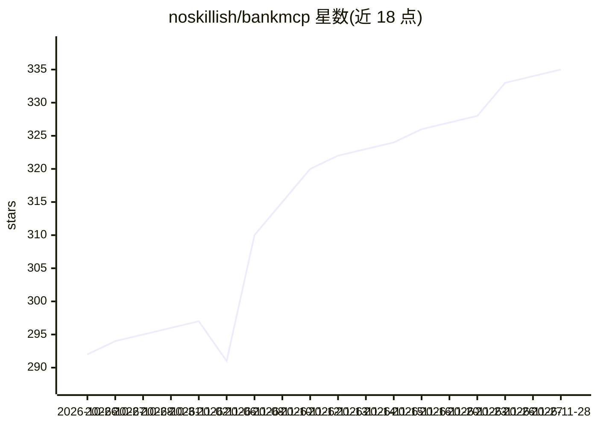

# noskillish/bankmcp

⭐ 335 · TypeScript · MIT · 推送 2026-10-22 · [GitHub](https://github.com/noskillish/bankmcp) · [官网](https://bankmcp.dk/) · 个人维护

**自托管只读 MCP 服务器：让 AI 助手读取你的银行账户**

开源 Node.js 服务器（npm 包 bankmcp），通过 Enable Banking 的 PSD2 API 连接 2,700+ 家欧洲银行，将余额与交易以 MCP 连接器形式暴露给任意 MCP 客户端。只读设计，无支付功能，不存储交易数据，不发遥测。支持本机 stdio 模式（Claude Desktop/Code、Cursor）与服务器部署（Railway/Fly.io/Render/Docker），内置 OAuth 2.1 单用户授权、余额/交易监控规则与 webhook 通知，另附 Claude Code 插件市场与本地 Ollama 桥接（实验性）。

## 筛选速览

| 维度 | 判定 | 备注 |
|---|---|---|
| AI 角色 | `ai-ecosystem` | LLM/agent 周边工具 |
| 许可风险 | `permissive` | MIT |
| 部署形态 | `self-host` | docker 或自建部署 |
| 模型依赖 | local-ok | 支持本地模型 |
| 硬件要求 | — | 无带数字的原话,不猜 |
| 安装摩擦 | `low` | 无编译、无系统依赖或容器化 |
| 成熟度 | — | 结构信号不足 |

## 能力要点

- 只读工具集：余额、交易、月度汇总、跨账户交易搜索
- 服务器端监控规则（Watches），每日最多四次轮询，webhook 通知
- 完整 OAuth 2.1 单用户授权服务器，令牌哈希存储
- 提供 Claude Code 插件（安装/部署/数据分析技能）

## 适用场景

- 用自然语言查询各银行账户余额与交易
- 审计每月订阅费用与异常支出
- 余额低于阈值时收到 webhook 通知
- 向第三方出具 IBAN 归属证明（默认关闭）

## 场景标签

`数据分析` · 领域:效率与自动化

## 证据(README 行号)

> L5: BankMCP™ is not a bank. It is a small open-source server you host yourself
> L8: European banks in one PSD2 API, and exposes them to any MCP client as a
> L257: The server does not care which model asks. `npm run chat` bridges an

## 星数曲线

2026-10-26 292 → 2026-11-28 335（+43）

---
*卡片 v1 · prompt 1.4 · 生成 2026-11-25 · 置信度 high · 依据 README sha `2b1afcba657b` · [字段定义](../../DATASET.md)*
