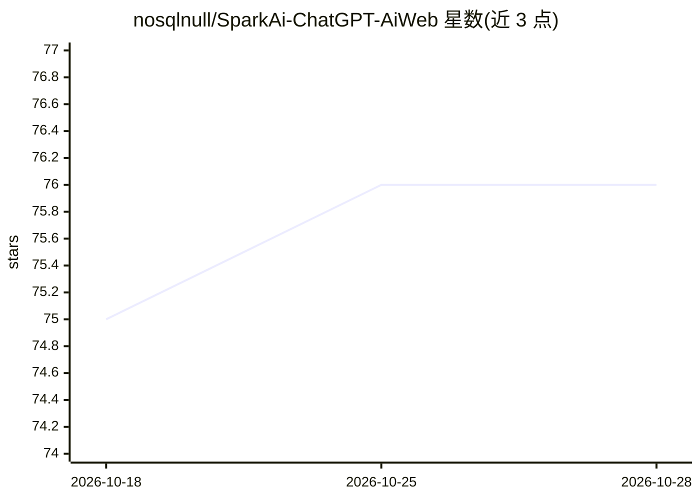

# nosqlnull/SparkAi-ChatGPT-AiWeb

⭐ 76 · JavaScript · NOASSERTION · 推送 2026-09-28 · [GitHub](https://github.com/nosqlnull/SparkAi-ChatGPT-AiWeb) · [官网](https://docs.sparkaigc.com) · 个人维护 · 中文 README

**可私有部署的 AIGC 商业网站系统：AI 对话/绘画/视频+会员支付**

面向 ToC/ToD/ToB 的一站式 AIGC 网站系统（公益免费商业版 Public Good V2.1.0，功能底座 V3.2.0）。系统本身不提供模型服务，AI 能力由使用者自行对接第三方模型 API（OpenAI、Claude、Gemini、DeepSeek、国内模型等，统一标准 chat 格式后台接入）；公益版含 GPT-3.5/4 对话、DALL·E 与 Midjourney 绘画、会员套餐、在线支付（易支付/码支付/虎皮椒）与分销推广等商业运营功能。源码不开源，以后端加密安装包发布；支持宝塔 Docker 商店一键部署或 Node.js 16 + PM2 + pnpm 运行（默认 9520 端口）。另存在付费商业授权版（V6.9.6）。

## 筛选速览

| 维度 | 判定 | 备注 |
|---|---|---|
| AI 角色 | `ai-native` | 本体是模型或模型工具 |
| 许可风险 | `none` | NOASSERTION |
| 部署形态 | `library` | 以包/库形式分发 |
| 模型依赖 | locked-api |  |
| 硬件要求 | — | 无带数字的原话,不猜 |
| 安装摩擦 | `low` | 无编译、无系统依赖或容器化 |
| 成熟度 | — | 结构信号不足 |

## 能力要点

- 系统仅提供站点软件，AI 能力全部由使用者对接第三方模型 API 提供
- 后台自定义接入大模型（商业版，无需系统更新）
- 会员套餐、易支付/码支付/虎皮椒在线支付、分销推广、卡密系统
- 支持宝塔 Docker 商店一键部署与 Node.js + PM2 部署

## 适用场景

- 搭建可商业运营的 AI 对话/绘画网站并收取会员费
- 企业内部私有化部署 AIGC 应用
- 通过分销推广机制运营 AI 站点

## 场景标签

`聊天机器人` `图像生成` · 领域:对话与助手

## 证据(README 行号)

> L34: > - SparkAi 是一套可私有化部署的 **AI 应用系统**（AIGC 网站系统软件），**不是 API 中转 / 代理系统**。
> L35: > - **系统本身不提供任何生成式人工智能服务，也不提供任何 AI 大模型、模型 API 及模型能力**；系统中的对话、绘画、视频等 AI 功能，均由使用者自行对接的第三方模型服务提供。
> L46: **SparkAi系统是一款支持多语言国际化的{ 渐进式 }AIGC系统，基于OpenAI/ChatGPT、最新旗舰大模型GPT-6、Anthropic Claude（Claude-Opus-5-5 / Claude-Fable-

## 星数曲线

2026-10-18 75 → 2026-10-28 76（+1）

---
*卡片 v1 · prompt 1.4 · 生成 2026-10-24 · 置信度 high · 依据 README sha `ad7ea1b79f57` · [字段定义](../../DATASET.md)*
