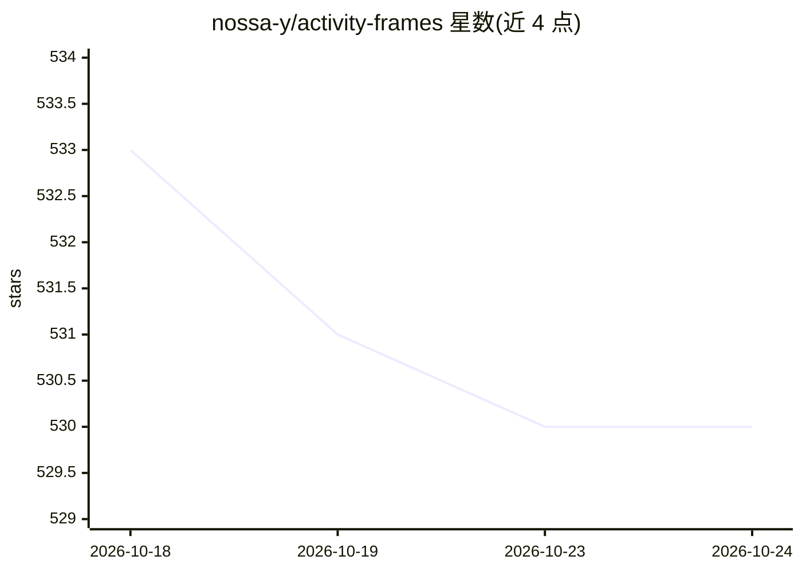

# nossa-y/activity-frames

⭐ 530 · Python · MIT · 推送 2026-08-26 · [GitHub](https://github.com/nossa-y/activity-frames) · 个人维护

**本地录制屏幕活动并编译为 agent 可用的结构化记忆与可执行工作流**

在本地录制屏幕快照、可访问性树与输入事件（SQLite 存储），用确定性代码将其编译为有边界的 activity frames：会话、停留时长、页面实体、重复模式等，输出可直接粘贴进系统提示的紧凑上下文块，并通过六个 MCP 工具供 agent 调用。重复性任务可编译为有序点击脚本供 agent 回放，回放路径无需模型调用。编译路径无 LLM 参与，采用 measured/inferred 两层契约，实测层可复现。默认捕获引擎为 nocta-recorder（macOS Apple Silicon 为主，Linux 需自带 recorder）。

## 筛选速览

| 维度 | 判定 | 备注 |
|---|---|---|
| AI 角色 | `ai-ecosystem` | LLM/agent 周边工具 |
| 许可风险 | `permissive` | MIT |
| 部署形态 | `library` | 以包/库形式分发 |
| 模型依赖 | — | README 未给出锁定关系 |
| 硬件要求 | — | 无带数字的原话,不猜 |
| 安装摩擦 | `low` | 无编译、无系统依赖或容器化 |
| 成熟度 | — | 结构信号不足 |

## 能力要点

- 屏幕活动编译为紧凑上下文块（一天 44 frames 约 1,371 tokens）
- 重复任务编译为有序脚本，agent 回放零模型调用
- 6 个 MCP 工具（get_context/get_steps/get_patterns 等）
- 纯本地运行，编译路径无 LLM，measured/inferred 两层证据契约

## 适用场景

- 让 computer-use agent 复用我做过的重复任务而不重复推理
- 把一天的电脑活动变成 agent 可查询的上下文记忆
- 检测重复点击/URL 模式等习惯性工作流

## 场景标签

`Agent 记忆` `GUI 自动化` · 领域:Agent 开发

## 证据(README 行号)

> L20: activity-frames fixes both. It records your screen locally and compiles what it sees into structured **activity fra
> L120: - **No LLM in the compile path.** Compilation is plain code, so no language model, local or remote, is involved in

## 星数曲线

2026-10-18 533 → 2026-10-24 530（-3）

---
*卡片 v1 · prompt 1.4 · 生成 2026-10-22 · 置信度 high · 依据 README sha `c6af2c984da1` · [字段定义](../../DATASET.md)*
