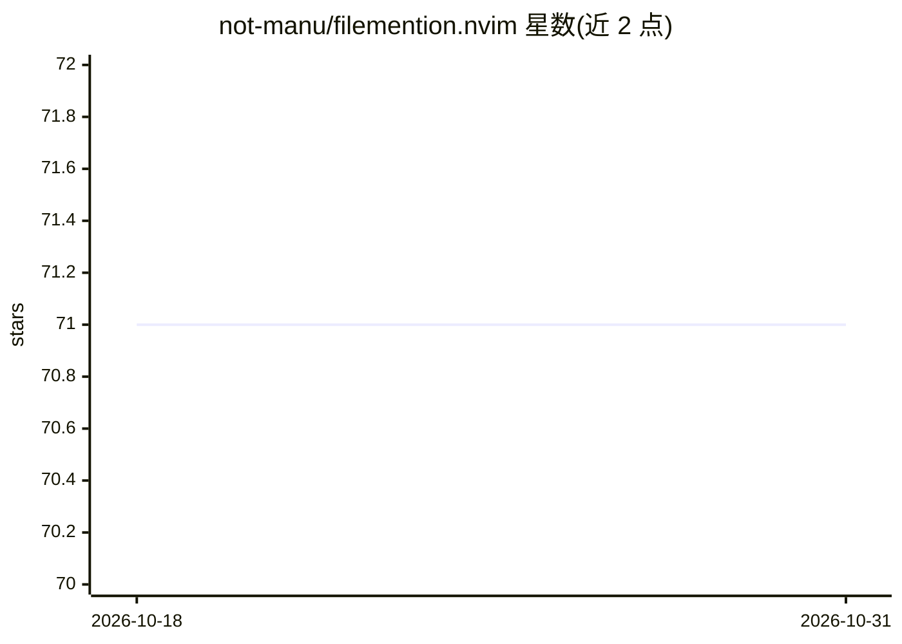

# not-manu/filemention.nvim

⭐ 71 · Lua · MIT · 推送 2026-05-30 · [GitHub](https://github.com/not-manu/filemention.nvim) · 个人维护

**Neovim 插件：插入模式下 @ 模糊选文件生成 @path 文件引用**

为 Neovim 提供的补全来源插件：在 markdown、text、gitcommit 等文本类 buffer 的插入模式下键入 @，模糊检索并插入 @path/to/file 形式的文件引用，用于撰写提示词、笔记与提交信息。文件发现按 fd → rg → 纯 Lua vim.fs.dir 顺序回退，根目录默认取 git root、回退 cwd；键入 [@ 可生成真实 markdown 链接；可选集成 fff.nvim 获得 frecency 排序。无补全引擎之外的硬依赖。

## 筛选速览

| 维度 | 判定 | 备注 |
|---|---|---|
| AI 角色 | `ai-enhanced` | 去掉 AI 部分产品仍成立 |
| 许可风险 | `permissive` | MIT |
| 部署形态 | `None` |  |
| 模型依赖 | — | README 未给出锁定关系 |
| 硬件要求 | — | 无带数字的原话,不猜 |
| 安装摩擦 | `low` | 无编译、无系统依赖或容器化 |
| 成熟度 | — | 结构信号不足 |

## 能力要点

- 插入模式 @ 触发模糊文件选择并生成 @path 引用
- 文件发现按 fd → rg → vim.fs.dir 自动回退
- 支持 nvim-cmp 与 blink.cmp 两种补全引擎
- [@ 触发可生成 markdown 链接形式

## 适用场景

- 写 LLM 提示词时快速引用仓库内文件路径
- 在 markdown 笔记或 git 提交信息中插入文件引用

## 场景标签

`提示工程` · 领域:Agent 开发

## 证据(README 行号)

> L3: type <code>@</code> in insert mode.
> L7: get a <code>@path/to/file</code> mention — native to nvim.

## 星数曲线

2026-10-18 71 → 2026-10-31 71（+0）

---
*卡片 v1 · prompt 1.4 · 生成 2026-10-24 · 置信度 mid · 依据 README sha `1879609801e8` · [字段定义](../../DATASET.md)*
