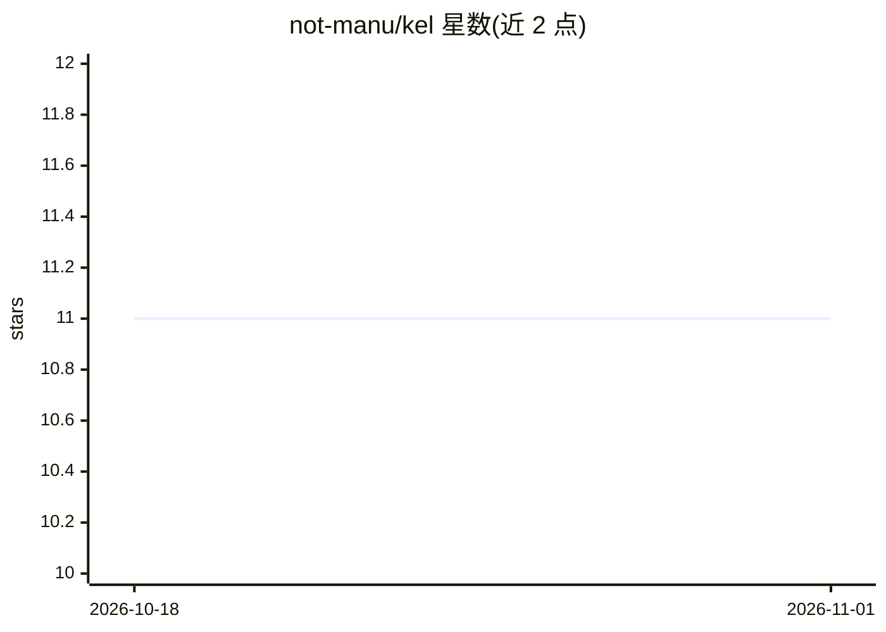

# not-manu/kel

⭐ 11 · TypeScript · MIT · 推送 2025-12-08 · [GitHub](https://github.com/not-manu/kel) · 个人维护

**常驻桌面的 AI 代理侧边栏应用，快捷键随时唤起**

基于 Electron 的桌面 AI agent 应用：通过 Control+K 全局快捷键以侧边栏形式唤起，与用户桌面共存。对话记录保存在本地 SQLite 数据库，README 声明数据在本地运行。模型接入通过 OpenRouter 提供多模型选择，技术栈为 React 19 + TypeScript + Vercel AI SDK。面向终端用户提供源码构建方式（Node.js 18+ 与 pnpm），无预编译安装包说明。

## 筛选速览

| 维度 | 判定 | 备注 |
|---|---|---|
| AI 角色 | `ai-native` | 本体是模型或模型工具 |
| 许可风险 | `permissive` | MIT |
| 部署形态 | `None` |  |
| 模型依赖 | locked-api |  |
| 硬件要求 | — | 无带数字的原话,不猜 |
| 安装摩擦 | `low` | 无编译、无系统依赖或容器化 |
| 成熟度 | — | 结构信号不足 |

## 能力要点

- Control+K 全局快捷键唤起的侧边栏窗口
- 对话记录本地 SQLite 存储，README 声明数据不离开本机
- 经 OpenRouter 接入多个 AI 模型
- Electron 多进程架构（主进程/预加载/渲染进程）

## 适用场景

- 在任意应用旁随时唤起 AI 助手对话
- 本地保存对话历史供后续查阅
- 通过 OpenRouter 切换不同模型使用

## 场景标签

`AI 助手` · 领域:对话与助手

## 证据(README 行号)

> L7: Kel is an AI agent desktop application that lives on your computer. Access it instantly with a keyboard shortcut (`C
> L17: - **Multi-Model Support**: Powered by OpenRouter, giving you access to multiple AI models

## 星数曲线

2026-10-18 11 → 2026-11-01 11（+0）

---
*卡片 v1 · prompt 1.4 · 生成 2026-11-01 · 置信度 high · 依据 README sha `06aba7e3609c` · [字段定义](../../DATASET.md)*
