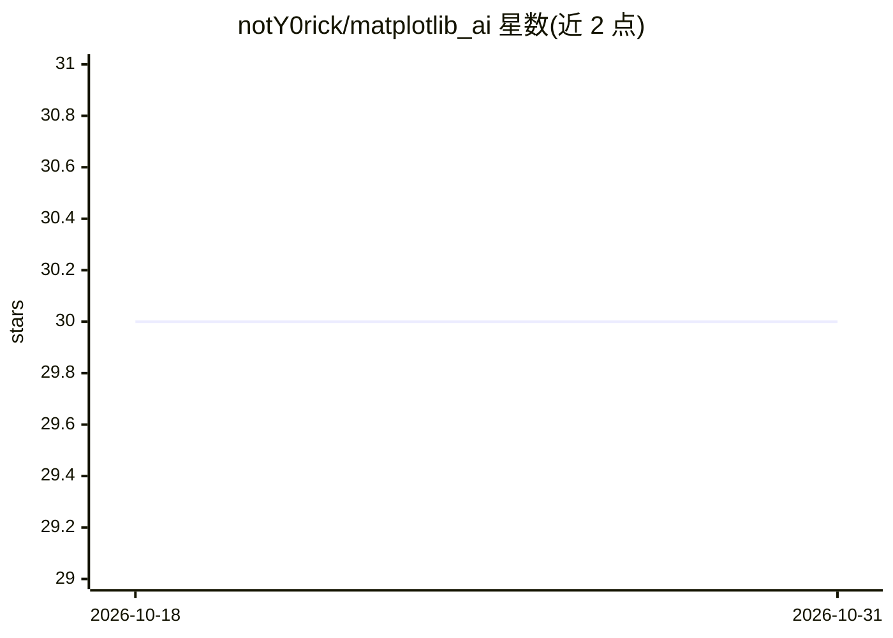

# notY0rick/matplotlib_ai

⭐ 30 · Jupyter Notebook · MIT · 推送 2026-04-10 · [GitHub](https://github.com/notY0rick/matplotlib_ai) · [官网](https://pypi.org/project/matplotlib-ai/) · 个人维护

**调用 GPT 用自然语言生成 matplotlib 图表代码的 Python 库**

Python 包，用户传入数据与自然语言提示，内部调用 OpenAI GPT API 结合提示工程与 few-shot 学习生成 matplotlib 绘图代码并返回，无需手写 matplotlib 代码。依赖 openai 与 matplotlib，使用需自备 OpenAI API key，以 pip 安装。作者自述项目处于早期阶段，功能尚待扩展。

## 筛选速览

| 维度 | 判定 | 备注 |
|---|---|---|
| AI 角色 | `ai-native` | 本体是模型或模型工具 |
| 许可风险 | `permissive` | MIT |
| 部署形态 | `library` | 以包/库形式分发 |
| 模型依赖 | — | README 未给出锁定关系 |
| 硬件要求 | — | 无带数字的原话,不猜 |
| 安装摩擦 | `low` | 无编译、无系统依赖或容器化 |
| 成熟度 | `idea` | |

## 能力要点

- 自然语言提示生成 matplotlib 绘图代码
- 调用 OpenAI GPT API，结合提示工程与 few-shot 学习
- 返回的生成代码可直接打印查看

## 适用场景

- 不想手写 matplotlib 代码的用户用一句话描述生成图表
- 快速为字典数据批量绘制曲线并自定义样式

## 场景标签

`代码生成` `数据分析` · 领域:效率与自动化

## 证据(README 行号)

> L2: Do you also have a love-hate relationship with matplotlib? So do I! That's why I created this mini-project that can 
> L26: from matplotlib_ai.matplotlib_ai import matplotlib_ai

## 星数曲线

2026-10-18 30 → 2026-10-31 30（+0）

---
*卡片 v1 · prompt 1.4 · 生成 2026-10-26 · 置信度 high · 依据 README sha `56449c42c93f` · [字段定义](../../DATASET.md)*
