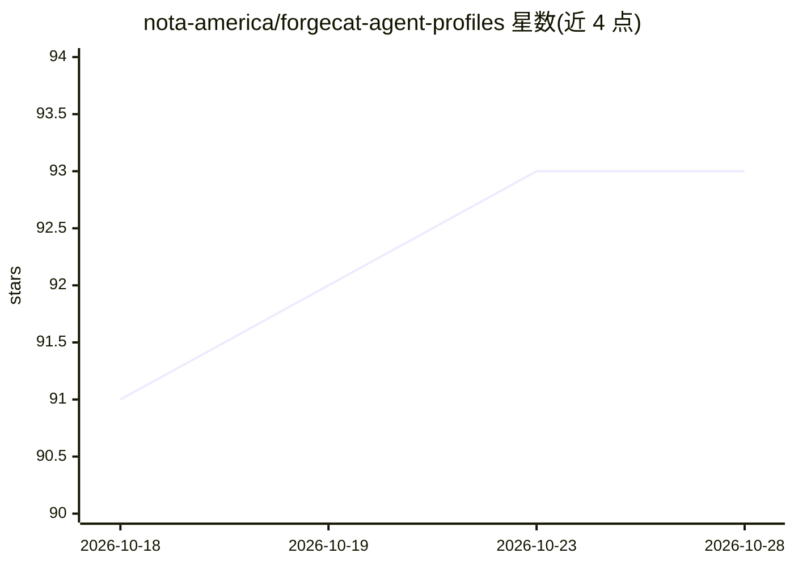

# nota-america/forgecat-agent-profiles

⭐ 93 · TypeScript · Apache-2.0 · 推送 2026-09-23 · [GitHub](https://github.com/nota-america/forgecat-agent-profiles) · [官网](https://forgecat.ai) · 组织维护

**跨平台 AI agent 配置档目录：搜索、安装可复用 agent 技能包**

面向使用 Claude Code、Cursor、Codex、OpenClaw、Hermes 等编码工具的开发者的公开目录：从开源项目收集 skills、agents、rules、commands、hooks 与 MCP 设置，打包为统一格式的 profile，经 ForgeCat CLI（npm 全局安装）搜索并按平台 ID 安装。收录 43 个集合共 193 个 profile，保留来源归属、许可证元数据与上游行为说明；平台标记为 tested 需通过实际安装/运行检查。上游维护者可通过 issue 模板请求更正、下架或转移所有权。

## 筛选速览

| 维度 | 判定 | 备注 |
|---|---|---|
| AI 角色 | `ai-knowledge` | 知识聚合/清单类 |
| 许可风险 | `permissive` | Apache-2.0 |
| 部署形态 | `library` | 以包/库形式分发 |
| 模型依赖 | — | README 未给出锁定关系 |
| 硬件要求 | — | 无带数字的原话,不猜 |
| 安装摩擦 | `low` | 无编译、无系统依赖或容器化 |
| 成熟度 | — | 结构信号不足 |

## 能力要点

- 同一 profile 源跨 5 个平台（Claude Code/Cursor/Codex/OpenClaw/Hermes）安装
- 43 个集合、193 个 profile，按来源 owner/repository 分组
- 保留来源链接、许可证元数据与转换说明
- 平台 tested 标记需实际安装/运行检查，含原生 artifact 校验

## 适用场景

- 为 Claude Code/Cursor/Codex 查找并安装现成的 agent 技能与工作流
- 把已有 agent 配置跨工具迁移复用
- 上游维护者管理被收录 profile 的归属与更正

## 场景标签

`精选清单` · 领域:学习与行业

## 证据(README 行号)

> L25: ForgeCat Agent Profiles is the public catalog for installable agent profiles: skills, agents, rules, commands, hook
> L64: |Find useful agent workflows|A curated catalog grouped by original source owner and repository|

## 星数曲线

2026-10-18 91 → 2026-10-28 93（+2）

---
*卡片 v1 · prompt 1.4 · 生成 2026-10-23 · 置信度 high · 依据 README sha `5dd2daa36115` · [字段定义](../../DATASET.md)*
