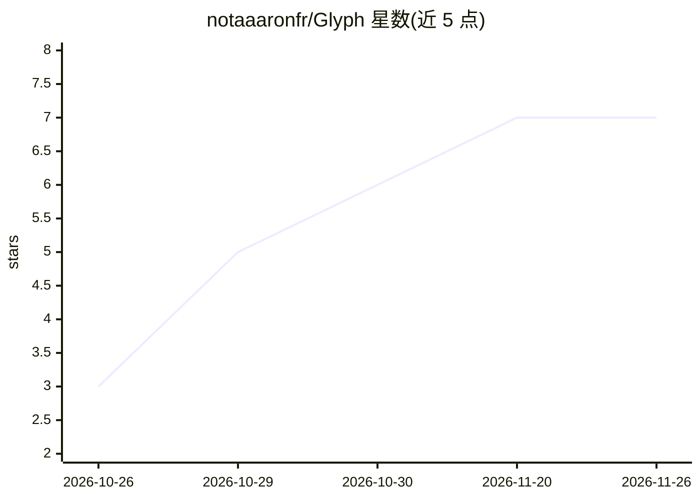

# notaaaronfr/Glyph

⭐ 7 · Rust · Apache-2.0 · 推送 2026-10-24 · [GitHub](https://github.com/notaaaronfr/Glyph) · 个人维护

**为 AI 写代码设计的效果系统编程语言，含契约检查与原生编译器**

用 Rust 实现的编程语言：函数签名声明效果（io/fs 等），编译期拒绝未声明的副作用；requires/ensures 契约在每次调用时检查并定位责任方；内置 test 块；glyph build 经 C 编译为原生可执行文件，用引用计数替代垃圾回收。面向 AI 生成代码的可信性场景：--json 输出诊断供 AI 自修复，glyph fix 调用 Claude 修复错误且仅接受通过全部静态检查、契约与测试的修复。支持 ARM64 裸机内核目标（Glyph OS），提供多应用隔离运行与运行时效果权限检查。

## 筛选速览

| 维度 | 判定 | 备注 |
|---|---|---|
| AI 角色 | `ai-enhanced` | 去掉 AI 部分产品仍成立 |
| 许可风险 | `permissive` | Apache-2.0 |
| 部署形态 | `library` | 以包/库形式分发 |
| 模型依赖 | locked-api |  |
| 硬件要求 | — | 无带数字的原话,不猜 |
| 安装摩擦 | `low` | 无编译、无系统依赖或容器化 |
| 成熟度 | — | 结构信号不足 |

## 能力要点

- 函数签名声明效果，编译期拒绝未声明的 io/fs 等副作用
- glyph fix 调用 Claude 修复，仅接受未新增效果、未削弱契约、通过全部测试的修复
- glyph build 经 C 编译为独立原生可执行文件，无垃圾回收（引用计数）
- --target kernel 构建 ARM64 裸机内核镜像，用户态隔离与运行时效果权限检查

## 适用场景

- 为 AI 生成的代码提供编译期效果与契约检查
- 用 glyph fix 让 AI 在受检约束下自动修复错误与测试
- 在无操作系统的 ARM64 设备上运行隔离的 Glyph 应用

## 场景标签

`编码 Agent` · 领域:编码与开发

## 证据(README 行号)

> L8: AI now writes much of the world's code, and the bottleneck has moved from *writing* code to *trusting* it. In Glyph,
> L26: - **AI fixes, checked.** `glyph fix` asks Claude to repair errors and failing tests, and accepts a fix only if it p
> L23: - **Native compiler.** `glyph build` produces a standalone executable. The test suite holds it to byte-identical be

## 星数曲线

2026-10-26 3 → 2026-11-26 7（+4）

---
*卡片 v1 · prompt 1.4 · 生成 2026-11-20 · 置信度 high · 依据 README sha `d77c4dfe34dd` · [字段定义](../../DATASET.md)*
