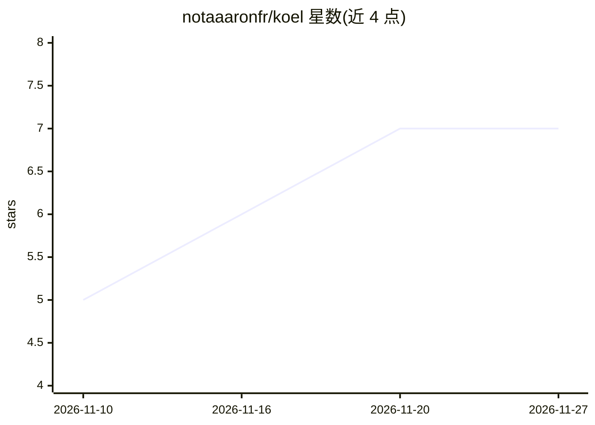

# notaaaronfr/koel

⭐ 7 · Python · MIT · 推送 2026-11-10 · [GitHub](https://github.com/notaaaronfr/koel) · [官网](https://www.charlesaarondavid.com/koel) · 个人维护

**面向癌症突变评分的开放校准检查工具：度量预测分数的可信证据量**

Koel 是一个可复现的分析流水线，用 CIViC、ClinVar、MaveDB 等开放数据度量 AlphaMissense 和 ESM1b 分数在癌基因与抑癌基因中分别赢得多少证据权重，输出 AUROC 对比、信任表（似然比映射到证据分）与留出集测试结果。通过 uv 运行，需约 3 GB 磁盘、无需 GPU，按模块组织数据源、标签表、校准与分析。声明仅限研究用途，不用于临床诊断；含预测分数的输出继承其非商业许可。

## 筛选速览

| 维度 | 判定 | 备注 |
|---|---|---|
| AI 角色 | `ai-native` | 本体是模型或模型工具 |
| 许可风险 | `permissive` | MIT |
| 部署形态 | `None` |  |
| 模型依赖 | — | README 未给出锁定关系 |
| 硬件要求 | — | 无带数字的原话,不猜 |
| 安装摩擦 | `low` | 无编译、无系统依赖或容器化 |
| 成熟度 | `idea` | |

## 能力要点

- 按基因类型分别校准 AlphaMissense/ESM1b 分数到 Tavtigian 证据等级
- 基因级重采样置信区间（重采样整个基因而非单个突变）
- 约 53,000 条 MaveDB 实验测量数据的对照分析
- 仅使用开放许可数据，全部结果可由 uv run koel all 复现

## 适用场景

- 评估 AI 致病性预测分数在 OP1 证据规则中应得的权重
- 比较癌基因与抑癌基因上预测工具的实验室测量表现
- 在 ClinVar 时间切分数据上做留出集检验

## 场景标签

`科研工具` · 领域:学习与行业

## 证据(README 行号)

> L37: **Koel measures, openly and reproducibly, how much weight a score has actually earned,
> L120: uv run koel all                 # build the table and run every analysis
> L153: |`calibrate.py`|trust table (likelihood ratios to evidence points)|

## 星数曲线

2026-11-10 5 → 2026-11-27 7（+2）

---
*卡片 v1 · prompt 1.4 · 生成 2026-11-20 · 置信度 mid · 依据 README sha `b53a431ff953` · [字段定义](../../DATASET.md)*
