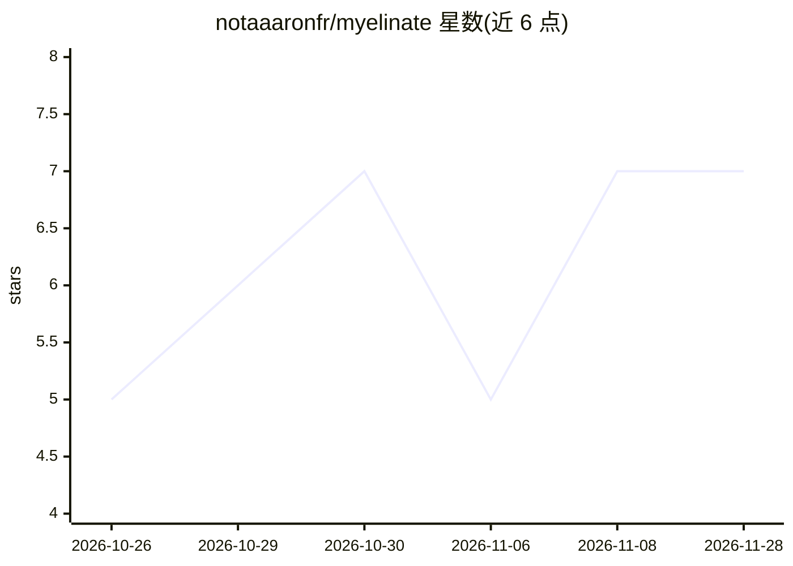

# notaaaronfr/myelinate

⭐ 7 · Python · MIT · 推送 2026-11-27 · [GitHub](https://github.com/notaaaronfr/myelinate) · [官网](https://notaaaronfr.github.io/myelinate/) · 个人维护

**给任意 agent 框架加自改进技能与记忆的治理网关**

Myelinate 是一个可挂接到任意 agent 框架的自改进组件：agent 每次运行前后调用 recall/record 两个接口，将 CI、测试、评审机器人、用户纠正等反馈转化为 SKILL.md 形式的技能与持久记忆。变更经证据门控、lint、灰度发布（canary）与留出对照组度量提升，支持版本、回滚与审计；接入方式包括 Microsoft Agent Framework 适配器、OpenClaw 插件、MCP 网关与 OpenTelemetry 零代码接入。生产部署提供 docker compose（网关、worker、Postgres）。

## 筛选速览

| 维度 | 判定 | 备注 |
|---|---|---|
| AI 角色 | `ai-ecosystem` | LLM/agent 周边工具 |
| 许可风险 | `permissive` | MIT |
| 部署形态 | `self-host` | docker 或自建部署 |
| 模型依赖 | — | README 未给出锁定关系 |
| 硬件要求 | — | 无带数字的原话,不猜 |
| 安装摩擦 | `low` | 无编译、无系统依赖或容器化 |
| 成熟度 | — | 结构信号不足 |

## 能力要点

- recall/record 两调用即可接入任意 agent 框架，支持 REST、MCP、OTLP 与适配器
- 技能以规则级 bullet 组织并导出为 SKILL.md，变更输出可评审 diff
- 内置贝叶斯灰度发布、留出对照组因果提升度量与回滚审计
- 双时间线记忆与矛盾调和（ADD/UPDATE/SUPERSEDE/NOOP）

## 适用场景

- 让团队 agent 从 CI 失败与评审反馈中积累规范类技能
- 为多 agent 系统统一管理学习到的技能并控制发布风险
- 度量学习机制对任务通过率的因果提升

## 场景标签

`Agent 记忆` · 领域:Agent 开发

## 证据(README 行号)

> L12: Myelinate plugs into any agent framework and turns feedback your team already has (tests, CI, review bots, user
> L63: A drop-in component that gives **any** agent framework a self-improvement loop: learned skills, persistent memory,
> L66: You attach it to Microsoft Agent Framework, OpenClaw, LangGraph, CrewAI, ADK or anything else. The agent stays

## 星数曲线

2026-10-26 5 → 2026-11-28 7（+2）

---
*卡片 v1 · prompt 1.4 · 生成 2026-11-20 · 置信度 mid · 依据 README sha `eba1defc1225` · [字段定义](../../DATASET.md)*
