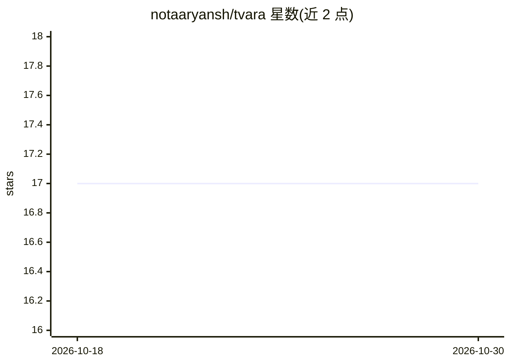

# notaaryansh/tvara

⭐ 17 · Swift · AGPL-3.0 · 推送 2026-08-24 · [GitHub](https://github.com/notaaryansh/tvara) · [官网](https://trytvara.com) · 个人维护

**macOS 全局统一搜索启动器，本地默认、AI 可选**

tvara 是一款 macOS 桌面启动器，用 ⌘K 从任意位置唤起，在单一搜索框内跨应用检索文件、消息（WhatsApp/iMessage/Discord）、邮件、笔记、剪贴板、浏览器历史与照片（MobileCLIP 端内语义搜索）。架构为按键扇出到本地数据源（mdfind、SQLite 直读、FTS 索引），结果流式汇入单一排序列表，并有按选取频率的 reranker。可选的 OpenAI BYOK 自然语言规划器解析模糊查询，无 key 时回落到字面关键词匹配；计划迁移到端内 LLM（Ollama 3B 或 Apple FoundationModels）。当前需从源码构建，需 macOS 14+、Xcode CLT 与签名证书；仍处活跃开发期，首个稳定版 WIP。

## 筛选速览

| 维度 | 判定 | 备注 |
|---|---|---|
| AI 角色 | `ai-enhanced` | 去掉 AI 部分产品仍成立 |
| 许可风险 | `viral` | AGPL-3.0 |
| 部署形态 | `None` |  |
| 模型依赖 | local-ok | 支持本地模型 |
| 硬件要求 | — | 无带数字的原话,不猜 |
| 安装摩擦 | `low` | 无编译、无系统依赖或容器化 |
| 成熟度 | `idea` | |

## 能力要点

- 单一搜索框跨 12 类本地数据源（文件/消息/邮件/笔记/照片等）
- 照片语义搜索用 MobileCLIP 端内运行，图像不离盘
- 可选 OpenAI BYOK 自然语言规划器，无 key 时回落本地关键词匹配
- 选取频率 reranker 逐步提升常用结果排名；零遥测

## 适用场景

- 在一个入口里搜散落在各 App 里的消息、邮件、笔记和照片
- 用自然语言描述找东西（如“上周给 Sam 发的地址”）
- 在 macOS 上做隐私优先、默认本地运行的快捷启动与搜索

## 场景标签

`语义搜索` · 领域:知识与检索

## 证据(README 行号)

> L17: tvara is one searchbox across all of them.
> L84: An optional natural-language planner (OpenAI today, on-device next)
> L130: Without an API key configured, none of these fire. Natural-language

## 星数曲线

2026-10-18 17 → 2026-10-30 17（+0）

---
*卡片 v1 · prompt 1.4 · 生成 2026-10-29 · 置信度 high · 依据 README sha `20aca202522c` · [字段定义](../../DATASET.md)*
