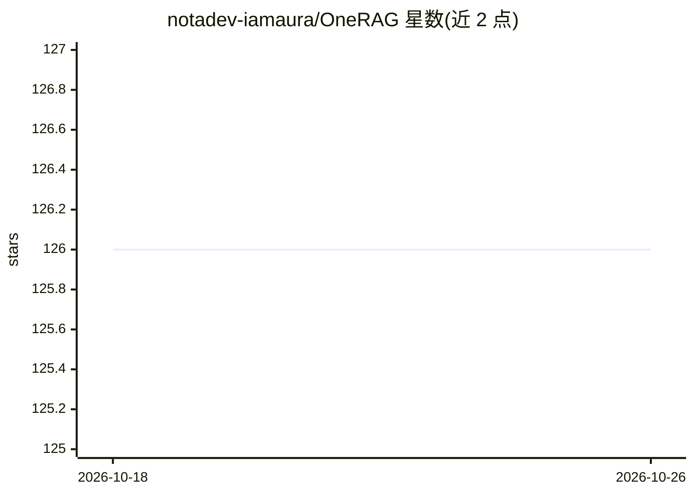

# notadev-iamaura/OneRAG

⭐ 126 · Python · MIT · 推送 2026-09-29 · [GitHub](https://github.com/notadev-iamaura/OneRAG) · [官网](https://github.com/notadev-iamaura/OneRAG) · 个人维护 · 中文 README

**组件可插拔的 RAG 后端框架：一行配置切换向量库与 LLM**

基于 Python/FastAPI 的 RAG 后端框架：检索 Provider（Weaviate/Chroma/Pinecone/Qdrant/pgvector/MongoDB + Grok 共 7 种）、LLM（Gemini/OpenAI/Claude/OpenRouter/Ollama 共 5 种）、Reranker（6 种）、Cache（3 种）均通过 .env 或 YAML 一行配置切换。提供 OpenAI 兼容 API（/v1/chat/completions）、Docker 一键 Full API 服务器与无需 Docker 的 CLI 快速启动（Ollama 本地 LLM 可无 API key 运行）。附带 React 前端 UI、GraphRAG、Agent（MCP）、韩语检索处理与 PII 掩码等功能，自述 2100+ 测试。

## 筛选速览

| 维度 | 判定 | 备注 |
|---|---|---|
| AI 角色 | `ai-ecosystem` | LLM/agent 周边工具 |
| 许可风险 | `permissive` | MIT |
| 部署形态 | `None` |  |
| 模型依赖 | local-ok | 支持本地模型 |
| 硬件要求 | — | 无带数字的原话,不猜 |
| 安装摩擦 | `low` | 无编译、无系统依赖或容器化 |
| 成熟度 | — | 结构信号不足 |

## 能力要点

- 配置一行切换 7 种检索 Provider 与 5 种 LLM
- OpenAI SDK 兼容 API，现有代码可直连
- Ollama 本地 LLM 支持无 API key、离线运行
- 附带 WebSocket 流式聊天与文档管理前端 UI

## 适用场景

- 快速搭建 RAG PoC 并沿用同一代码库扩展到生产
- 按环境切换向量数据库与 LLM 供应商
- 用 OpenAI SDK 现有工具直连自建 RAG 服务

## 场景标签

`RAG` `文档问答` · 领域:知识与检索

## 证据(README 行号)

> L36: - **설정만 바꾸면 끝** — 검색 Provider(7모드: Vector DB 6종 + Grok), LLM(5종), Reranker(6종), Cache(3종) 모두 `.env` 또는 YAML로 교체
> L38: - **OpenAI SDK 호환** — 기존 OpenAI 코드 그대로 OneRAG에 연결 (`/v1/chat/completions`)
> L124: `.env` 또는 YAML 설정만 변경하면 모든 컴포넌트를 교체할 수 있습니다.

## 星数曲线

2026-10-18 126 → 2026-10-26 126（+0）

---
*卡片 v1 · prompt 1.4 · 生成 2026-10-23 · 置信度 high · 依据 README sha `dec375e631a7` · [字段定义](../../DATASET.md)*
