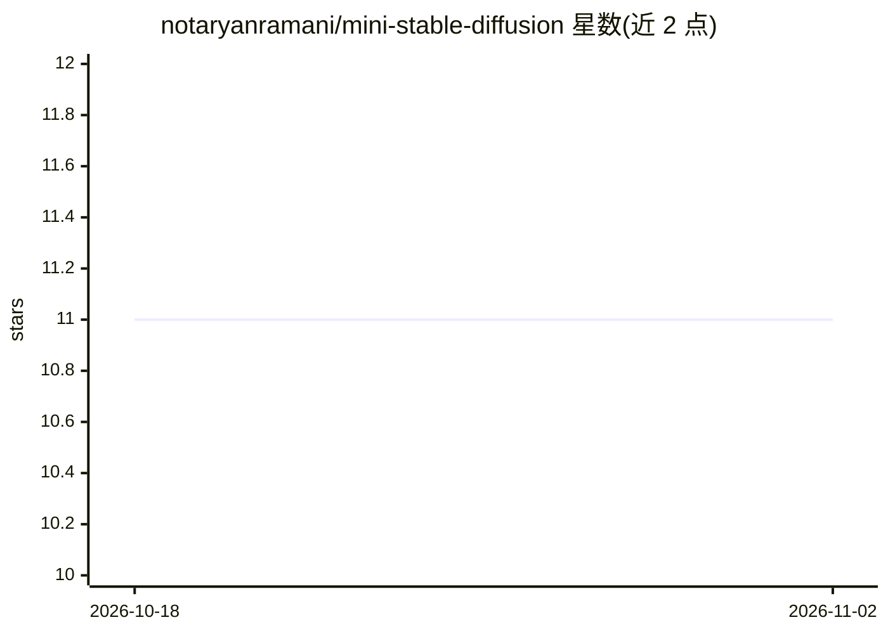

# notaryanramani/mini-stable-diffusion

⭐ 11 · Python · 推送 2026-04-29 · [GitHub](https://github.com/notaryanramani/mini-stable-diffusion) · 个人维护

**仅用 PyTorch 的精简 Stable Diffusion 文生图实现**

Stable Diffusion 架构的最小化 PyTorch 复现项目，支持 text-to-image 与 image-to-image 生成。文本条件部分使用 CLIP 与 BERT 做嵌入（作者用 BERT 做研究，考察其对图像生成的贡献），VAE 编解码器与含较少 DownConv/UpConv 层的小型 UNet 构成主干，因训练资源受限而缩小架构，定位为复现与理解扩散模型工作原理。提供 main.py 训练示例与 requirements.txt 安装流程，附两篇原始论文出处。

## 筛选速览

| 维度 | 判定 | 备注 |
|---|---|---|
| AI 角色 | `ai-native` | 本体是模型或模型工具 |
| 许可风险 | `none` | — |
| 部署形态 | `library` | 以包/库形式分发 |
| 模型依赖 | — | README 未给出锁定关系 |
| 硬件要求 | — | 无带数字的原话,不猜 |
| 安装摩擦 | `low` | 无编译、无系统依赖或容器化 |
| 成熟度 | — | 结构信号不足 |

## 能力要点

- 仅依赖 PyTorch 实现的 Stable Diffusion 精简架构
- 文本嵌入同时使用 CLIP 与 BERT 以做研究对比
- 提供训练示例代码（main.py）与 venv 安装流程

## 适用场景

- 学习扩散模型各模块（VAE/UNet/条件嵌入）的实现
- 研究 BERT 文本嵌入对文生图的贡献
- 在有限资源下训练小型文生图模型

## 场景标签

`图像生成` `教程课程` · 领域:内容生成

## 证据(README 行号)

> L3: Welcome to Mini Stable Diffusion! This is a simple minimal implementation of one of the most (if not the most) popul
> L27: This architecture uses lesser DownConv and UpConv layers in UNet which means this is a smaller achitecture as compa

## 星数曲线

2026-10-18 11 → 2026-11-02 11（+0）

---
*卡片 v1 · prompt 1.4 · 生成 2026-11-01 · 置信度 high · 依据 README sha `19033a2b9ecf` · [字段定义](../../DATASET.md)*
