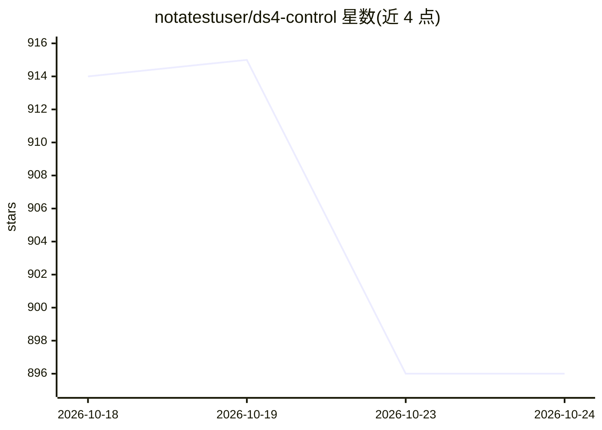

# notatestuser/ds4-control

⭐ 888 · Swift · MIT · 推送 2026-09-19 · [GitHub](https://github.com/notatestuser/ds4-control) · [官网](https://github.com/antirez/ds4) · 个人维护

**macOS 菜单栏应用：启动并监管本地 DeepSeek V4 系列模型服务**

面向 Apple Silicon Mac 用户的菜单栏工具：以子进程方式启动、监管和监控本地 ds4-server，提供 V4 Pro/Flash 变体选择、RAM 可行性门控、模型并行下载（可断点续传）与内存/GPU/CPU/功耗资源监视，支持配置最高 1M 上下文。自身不含推理引擎，推理全部委托 ds4-server；可拉起 Chat、Claude Code、Pi 或自定义 CLI 做本地 agentic coding。提供 .dmg 与 Homebrew Cask 安装。

## 筛选速览

| 维度 | 判定 | 备注 |
|---|---|---|
| AI 角色 | `ai-ecosystem` | LLM/agent 周边工具 |
| 许可风险 | `permissive` | MIT |
| 部署形态 | `desktop` | 安装包/桌面程序 |
| 模型依赖 | — | README 未给出锁定关系 |
| 硬件要求 | — | 无带数字的原话,不猜 |
| 安装摩擦 | `low` | 无编译、无系统依赖或容器化 |
| 成熟度 | — | 结构信号不足 |

## 能力要点

- 启动/停止/监控 ds4-server 子进程：就绪检测、健康轮询、崩溃检测
- 变体选择带 RAM 可行性检查，SSD 流式分级说明明确
- 内置原生并行下载器下载模型权重，可跨重启续传
- 采样内存/GPU/CPU/功耗并显示资源小组件

## 适用场景

- 在 Mac 上运行本地 DeepSeek V4 系列模型并监控资源占用
- 按本机 RAM 判断可运行哪个 V4 变体与量化档
- 从菜单栏一键拉起本地聊天或 Claude Code/Pi 编码代理

## 场景标签

 · 领域:本地 LLM 桌面工具/模型运行管理

## 证据(README 行号)

> L7: It launches, supervises, and monitors a local ds4 server, lets you pick **V4.1 Flash**, **V4 Pro (0813)**, or **V4 F
> L43: - No embedded inference — all inference is delegated to `ds4-server`.

## 星数曲线

2026-10-18 914 → 2026-10-24 896（-18）

---
*卡片 v1 · prompt 1.4 · 生成 2026-10-21 · 置信度 high · 依据 README sha `9b1ccf6c15d5` · [字段定义](../../DATASET.md)*
