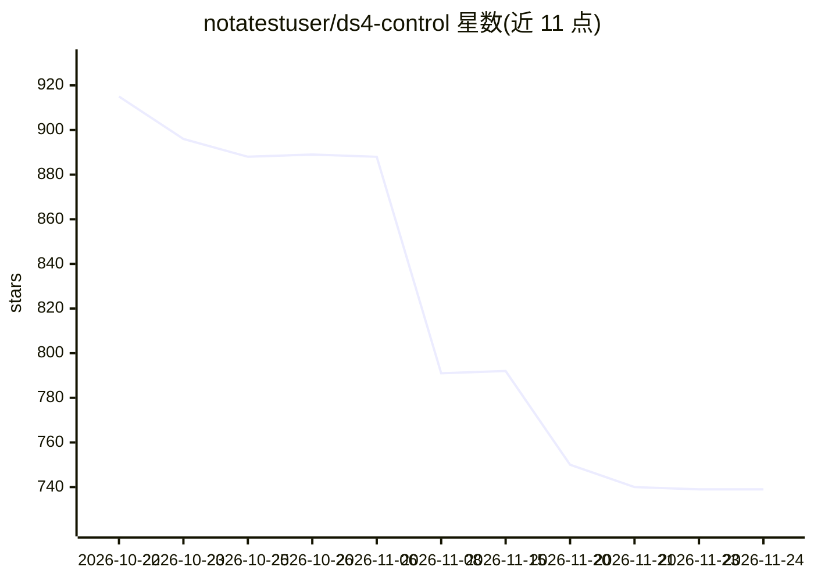

# notatestuser/ds4-control

⭐ 739 · Swift · MIT · 推送 2026-10-26 · [GitHub](https://github.com/notatestuser/ds4-control) · [官网](https://github.com/antirez/ds4) · 个人维护

**macOS 菜单栏应用：启动、监控本地 DeepSeek V4 服务并管理模型下载**

面向 macOS 用户的 DeepSeek V4/V4.1 本地运行管理面板：通过 dwarfstar（antirez/ds4）启动并监督 ds4-server 子进程，提供 Pro/Flash 模型选择（最高 1M 上下文）、RAM 可行性门槛检查、内置并行下载器（断点续传、SHA-256 校验、分片组装）、统一内存/GPU/CPU/功耗小部件，并可拉起 Chat 或 Claude Code/Pi 等 CLI 做本地编码。无内嵌推理，全部委托 ds4-server。仅支持 Apple Silicon，各量化变体要求 96–512 GiB 内存不等。

## 筛选速览

| 维度 | 判定 | 备注 |
|---|---|---|
| AI 角色 | `ai-ecosystem` | LLM/agent 周边工具 |
| 许可风险 | `permissive` | MIT |
| 部署形态 | `desktop` | 安装包/桌面程序 |
| 模型依赖 | locked-api |  |
| 硬件要求 | — | 无带数字的原话,不猜 |
| 安装摩擦 | `low` | 无编译、无系统依赖或容器化 |
| 成熟度 | — | 结构信号不足 |

## 能力要点

- 启动/停止/监督本地 ds4-server：stderr 就绪检测、健康轮询、崩溃检测
- 内置并行模型下载器，支持分片 SHA-256 校验与断点续传
- 按 RAM 做 Pro/Flash 变体可行性门槛与默认上下文推导
- 菜单栏展示统一内存、GPU、CPU、功耗指标

## 适用场景

- 在 Apple Silicon Mac 上一键管理 DeepSeek V4 本地服务与模型权重
- 配合 Claude Code/Pi 等 CLI 做本地 agentic 编码
- 根据机器内存选择合适的量化变体与上下文长度

## 场景标签

 · 领域:LLM 基础设施/本地推理管理

## 证据(README 行号)

> L5: A macOS menu bar pane for **DeepSeek V4** and **V4.1** via `dwarfstar`.
> L7: It launches, supervises, and monitors a local ds4 server, lets you pick **V4.1 Flash 1017**, **V4 Pro (0813)**, or *
> L43: - No embedded inference — all inference is delegated to `ds4-server`.

## 星数曲线

2026-10-22 915 → 2026-11-24 739（-176）

---
*卡片 v1 · prompt 1.4 · 生成 2026-11-24 · 置信度 high · 依据 README sha `0a29ceff7299` · [字段定义](../../DATASET.md)*
