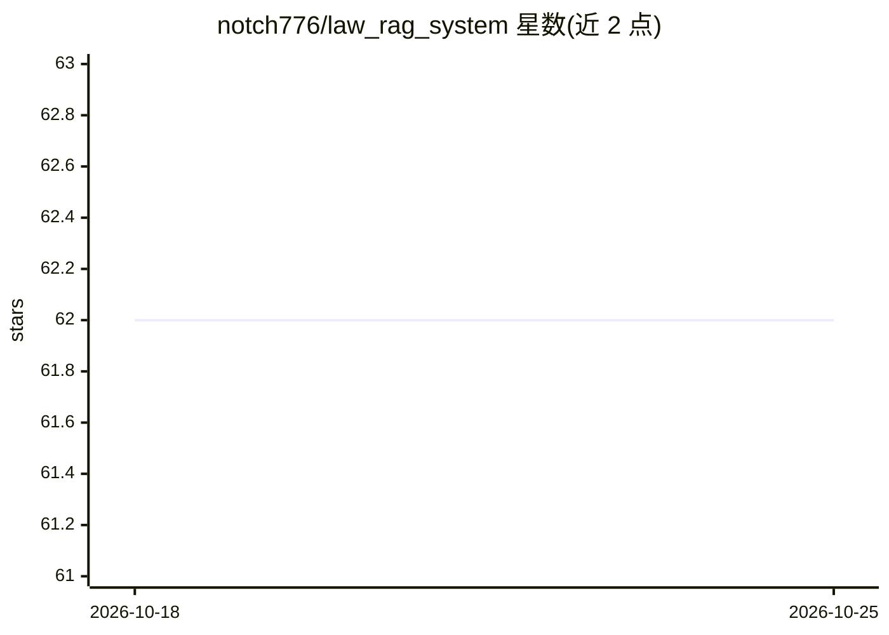

# notch776/law_rag_system

⭐ 62 · Python · 推送 2026-06-28 · [GitHub](https://github.com/notch776/law_rag_system) · 个人维护 · 中文 README

**面向公司法的 RAG 问答系统：多路召回+重排的法律问答**

基于 Python/FastAPI/Vue3 的企业法律（公司法）RAG 问答系统。检索采用向量召回（Elasticsearch + IK 分词）、BM25 与规则触发三路召回并用 RRF 融合，再用 BGE-reranker-large 重排；生成调用 DashScope 的 Qwen-Max，向量化使用阿里云文本 Embedding 模型。Redis 存短期对话、Neo4j 树结构存长期历史、MongoDB 存问答对，并通过 WebSocket 实现人工客服接管。需自行修改连接 URI 后以 Docker 部署，系统依赖多（MySQL/ES/Redis/MongoDB/Neo4j）。

## 筛选速览

| 维度 | 判定 | 备注 |
|---|---|---|
| AI 角色 | `ai-native` | 本体是模型或模型工具 |
| 许可风险 | `none` | — |
| 部署形态 | `self-host` | docker 或自建部署 |
| 模型依赖 | — | README 未给出锁定关系 |
| 硬件要求 | — | 无带数字的原话,不猜 |
| 安装摩擦 | `low` | 无编译、无系统依赖或容器化 |
| 成熟度 | — | 结构信号不足 |

## 能力要点

- 向量+BM25+规则三路召回，RRF 融合
- BGE-reranker-large 重排与上下文长度控制
- Redis 短期记忆 + Neo4j 树结构长期对话历史
- WebSocket 实时人工客服接管检测

## 适用场景

- 企业法律条文的智能问答客服
- 需要跨多文档推理、关键词条件稀疏的法律检索
- AI 与人工客服混合的对话服务场景

## 场景标签

`RAG` `聊天机器人` · 领域:对话与助手

## 证据(README 行号)

> L3: This project is a corporate law RAG (Retrieval-Augmented Generation) Q&A system. It employs Alibaba Cloud General Te
> L16: Backend Framework: FastAPI
> L30: DashScope API integration for Qwen-Max LLM

## 星数曲线

2026-10-18 62 → 2026-10-25 62（+0）

---
*卡片 v1 · prompt 1.4 · 生成 2026-10-24 · 置信度 high · 依据 README sha `a4431813fa5b` · [字段定义](../../DATASET.md)*
