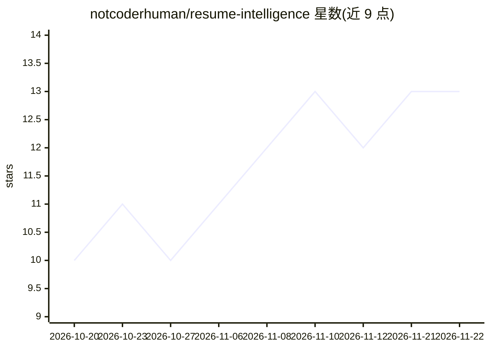

# notcoderhuman/resume-intelligence

⭐ 13 · JavaScript · MIT · 推送 2026-09-08 · [GitHub](https://github.com/notcoderhuman/resume-intelligence)

**给求职者的证据可溯简历-岗位匹配与技能差距分析工具**

本地运行的简历与职位描述分析工作区：结构化简历编辑器配合确定性 JD 解析与匹配，给出 requirement 级状态、置信值、从需求到简历原文的证据溯源、技能差距分析与 PDF 导出。设计上确定性分析为权威结果，AI（Ollama 本地模型或 Gemini）仅作咨询层，输出须经完整性校验，不合格则回退到确定性基线；简历或 JD 变更会使既有分析失效。Node.js+Express 后端，浏览器本地存储数据。

## 筛选速览

| 维度 | 判定 | 备注 |
|---|---|---|
| AI 角色 | `ai-enhanced` | 去掉 AI 部分产品仍成立 |
| 许可风险 | `permissive` | MIT |
| 部署形态 | `library` | 以包/库形式分发 |
| 模型依赖 | local-ok | 支持本地模型 |
| 硬件要求 | — | 无带数字的原话,不猜 |
| 安装摩擦 | `low` | 无编译、无系统依赖或容器化 |
| 成熟度 | — | 结构信号不足 |

## 能力要点

- 需求级证据溯源：从 JD 要求追到简历原文路径
- 确定性匹配与技能差距分析不依赖 AI 即可运行
- 可选 Ollama（qwen2.5:3b）或 Gemini 咨询层，含输出完整性校验与确定性回退
- PDF 导出、数据本地持久化与旧数据迁移

## 适用场景

- 对照目标职位检查简历哪些要求有实际证据支撑
- 按技能差距清单确定简历改进优先级
- 离线本地环境做简历-岗位匹配并保护隐私

## 场景标签

## 证据(README 行号)

> L3: Resume Intelligence is an evidence-grounded resume and job-description analysis workspace. It helps you structure a 
> L48: - Deterministic analysis remains authoritative.
> L193: Ollama is optional. The deterministic analyzer, matcher, evidence view, and skill-gap analysis work without AI.

## 星数曲线

2026-10-20 10 → 2026-11-22 13（+3）

---
*卡片 v1 · prompt 1.4 · 生成 2026-11-18 · 置信度 high · 依据 README sha `a5f6d808a82b` · [字段定义](../../DATASET.md)*
