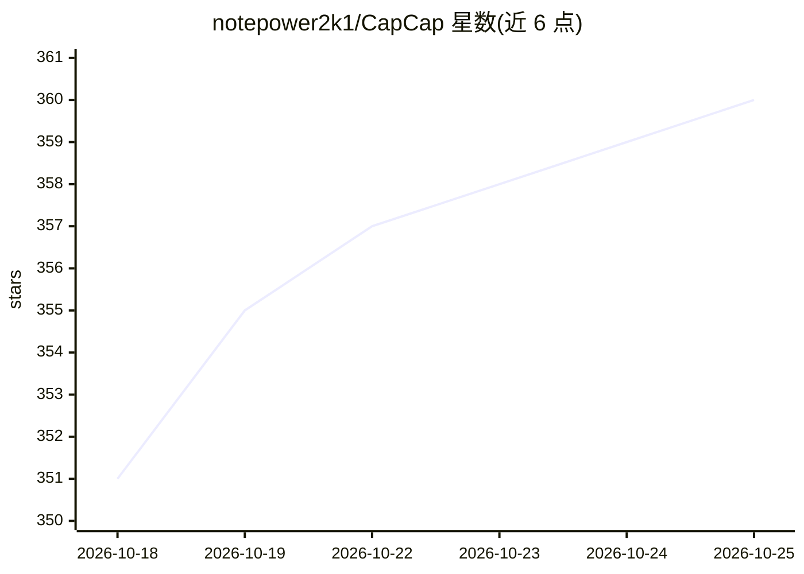

# notepower2k1/CapCap

⭐ 360 · Python · Apache-2.0 · 推送 2026-10-20 · [GitHub](https://github.com/notepower2k1/CapCap) · 个人维护 · 中文 README

**Windows 短视频本地化与配音的桌面一站式工具**

面向越南语内容制作者的 Windows 桌面应用，将语音识别（STT/OCR）、AI 翻译、TTS 配音、时间线编辑、预览与导出整合为 5 步项目工作流。翻译集成 Gemini 2.5、GPT-4o、DeepSeek、Ollama（离线）及 Google/Bing 翻译，配音支持 ElevenLabs、Piper（离线）、Edge TTS、CapCut TTS、VieNeu TTS。界面自适应 16:9 与 9:16 布局，导出支持 NVIDIA NVENC 硬件加速并可直接输出 CapCut Draft。预览依赖 libmpv，需 Microsoft Visual C++ 2015–2022 Redistributable (x64)。

## 筛选速览

| 维度 | 判定 | 备注 |
|---|---|---|
| AI 角色 | `ai-native` | 本体是模型或模型工具 |
| 许可风险 | `permissive` | Apache-2.0 |
| 部署形态 | `desktop` | 安装包/桌面程序 |
| 模型依赖 | local-ok | 支持本地模型 |
| 硬件要求 | — | 无带数字的原话,不猜 |
| 安装摩擦 | `low` | 无编译、无系统依赖或容器化 |
| 成熟度 | — | 结构信号不足 |

## 能力要点

- 5 步工作流：准备→STT/OCR→AI 翻译→TTS 配音→导出
- 多模型翻译通道（Gemini 2.5/GPT-4o/DeepSeek/Ollama 离线/Google/Bing）
- 多种 TTS 引擎（ElevenLabs/Piper 离线/Edge/CapCut/VieNeu 声音克隆）
- NVENC 硬件加速导出与 CapCut Draft 项目输出

## 适用场景

- 把 YouTube/TikTok 短视频翻译并配音成越南语
- 在时间线中编辑字幕、添加 Logo/模糊/遮罩/文字后导出成片
- 保留背景音乐，仅替换原视频人声进行本地化配音

## 场景标签

`语音合成` `语音识别` `OCR` `图像视频处理` · 领域:内容生成

## 证据(README 行号)

> L20: **CapCap** là ứng dụng biên tập và bản địa hóa video tất-cả-trong-một dành cho Windows. Giúp tự động hóa toàn bộ qu
> L24: * 🔄 **Quy trình 5 bước trực quan:** Chuẩn bị → Chép lời (STT / OCR) → Dịch AI → Lồng tiếng (TTS) → Xuất video.
> L26: * 🧠 **Dịch thuật AI chuẩn ngữ cảnh & xưng hô:** Tích hợp Gemini 2.5, GPT-4o, DeepSeek, Ollama (offline) cùng Google

## 星数曲线

2026-10-18 351 → 2026-10-25 360（+9）

---
*卡片 v1 · prompt 1.4 · 生成 2026-10-21 · 置信度 high · 依据 README sha `156ce6e25e3e` · [字段定义](../../DATASET.md)*
