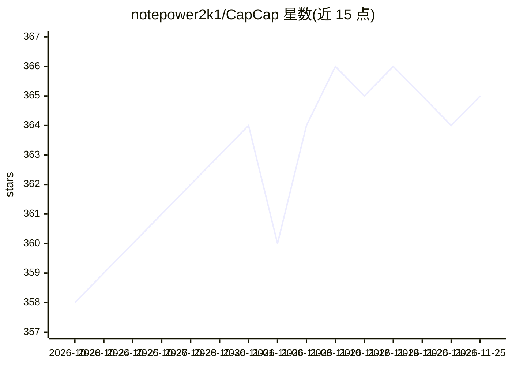

# notepower2k1/CapCap

⭐ 365 · Python · Apache-2.0 · 推送 2026-11-18 · [GitHub](https://github.com/notepower2k1/CapCap) · 个人维护

**Windows 视频本地化配音工具：转写+翻译+配音+导出一站式**

面向 Windows 的短视频本地化与配音桌面应用，将语音识别（STT/OCR）、AI 翻译、TTS 配音、字幕样式、多轨时间线编辑、预览与视频导出整合为单一项目流程。翻译接入多个模型服务并支持本地 Ollama 离线运行，配音支持多个 TTS 后端，可自动分离人声并保留背景音乐；导出支持 NVIDIA NVENC 硬件加速与导出为 CapCut 草稿继续剪辑。提供 16:9 与 9:16 自适应界面，Quality/Performance 两种性能模式；Quality 模式预览需 libmpv 及 VC++ 运行库。采用 Apache 2.0 许可。

## 筛选速览

| 维度 | 判定 | 备注 |
|---|---|---|
| AI 角色 | `ai-native` | 本体是模型或模型工具 |
| 许可风险 | `permissive` | Apache-2.0 |
| 部署形态 | `desktop` | 安装包/桌面程序 |
| 模型依赖 | local-ok | 支持本地模型 |
| 硬件要求 | — | 无带数字的原话,不猜 |
| 安装摩擦 | `low` | 无编译、无系统依赖或容器化 |
| 成熟度 | — | 结构信号不足 |

## 能力要点

- 五步流程：准备→STT/OCR 转写→AI 翻译→TTS 配音→导出视频
- 翻译接入 Gemini 2.5、GPT-4o、DeepSeek 与 Ollama（离线）
- TTS 支持 ElevenLabs、Piper（离线）、Edge TTS、CapCut TTS、VieNeu TTS
- 导出支持 NVIDIA NVENC GPU 加速及导出 CapCut 草稿

## 适用场景

- 将英文视频转写、翻译并配音成其他语言发布
- 为 TikTok/Shorts 等竖屏平台批量本地化短视频
- 需要离线环境时用 Ollama 与 Piper 完成翻译与配音
- 导出 CapCut 草稿做进一步精细剪辑

## 场景标签

`语音合成` `语音识别` `OCR` · 领域:内容生成

## 证据(README 行号)

> L20: **CapCap** là ứng dụng biên tập và bản địa hóa video tất-cả-trong-một dành cho Windows. Giúp tự động hóa toàn bộ qu
> L26: * 🔄 **Quy trình 5 bước trực quan:** Chuẩn bị → Chép lời (STT / OCR) → Dịch AI → Lồng tiếng (TTS) → Xuất video.

## 星数曲线

2026-10-23 358 → 2026-11-25 365（+7）

---
*卡片 v1 · prompt 1.4 · 生成 2026-11-25 · 置信度 high · 依据 README sha `a36a13a39876` · [字段定义](../../DATASET.md)*
