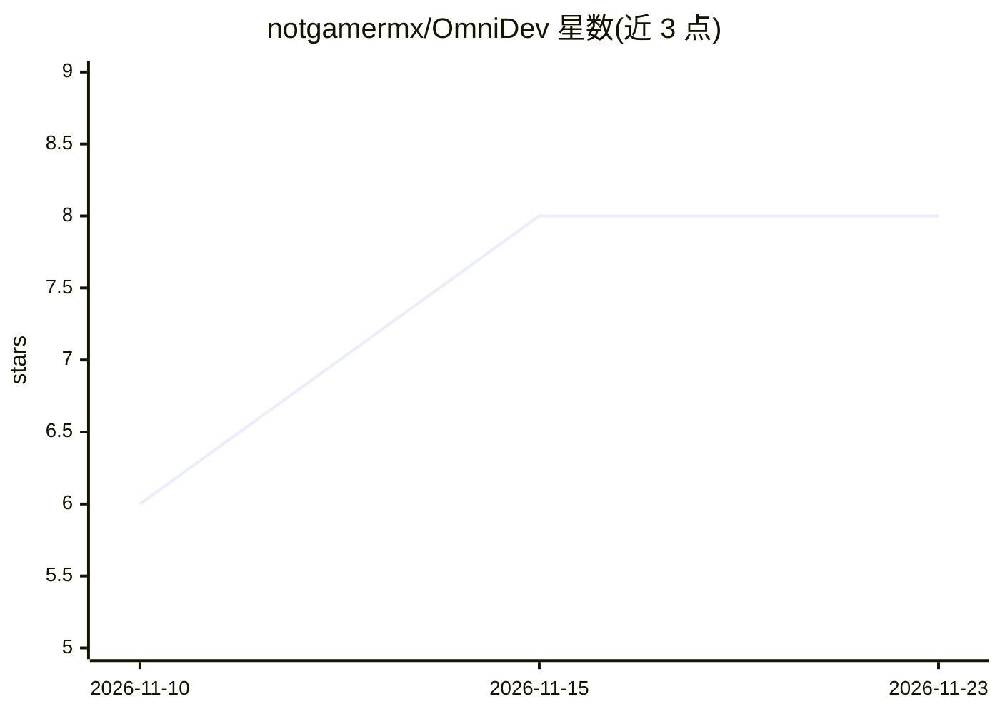

# notgamermx/OmniDev

⭐ 8 · Python · MIT · 推送 2026-11-22 · [GitHub](https://github.com/notgamermx/OmniDev) · 个人维护

**面向开发者的本地 AI 辅助开发工作台（桌面/网页/CLI）**

基于 FastAPI 引擎与 Tauri 桌面端的 AI 辅助软件开发工作台，提供网页、桌面、CLI 三个入口共用同一引擎。核心机制：Chat 对话选定模型、带受限工具的 agent 执行（Docker 容器隔离：无网络、只读系统文件系统、CPU/内存/时间限制）、OmniMode 将一个任务并发发给最多五个专家 agent 再交独立 reviewer 交叉核对、SQLite 本地存储会话与项目记忆。限制：Shell 执行需 Docker Desktop；包未签名；单引擎内无按用户隔离。

## 筛选速览

| 维度 | 判定 | 备注 |
|---|---|---|
| AI 角色 | `ai-native` | 本体是模型或模型工具 |
| 许可风险 | `permissive` | MIT |
| 部署形态 | `self-host` | docker 或自建部署 |
| 模型依赖 | local-ok | 支持本地模型 |
| 硬件要求 | — | 无带数字的原话,不猜 |
| 安装摩擦 | `low` | 无编译、无系统依赖或容器化 |
| 成熟度 | — | 结构信号不足 |

## 能力要点

- 网页、Tauri 桌面、CLI 三入口共用同一引擎与项目数据
- agent 任务在无网络、受限资源的 Docker 容器中执行
- OmniMode：最多 5 个专家 agent 并发 + 独立 reviewer 交叉核对
- 内置 14 家 provider 适配器，Ollama 本地运行无需 API key

## 适用场景

- 在本地工作台中与模型对话并让 agent 执行带验证命令的开发任务
- 同一任务并发发给多个专家 agent 并交叉核对结果
- 在受限容器中安全运行 agent 的文件与终端操作

## 场景标签

`编码 Agent` `多智能体` · 领域:Agent 开发

## 证据(README 行号)

> L3: A local workspace for AI-assisted software development. Chat with your chosen model, run agents with scoped tools, e
> L25: - **Three entry points:** web, Tauri desktop, and CLI use the same engine and project data.
> L64: Built-in adapters include Google Gemini, Groq, OpenRouter, Ollama, Mistral, Cloudflare Workers AI, Cohere, NVIDIA N

## 星数曲线

2026-11-10 6 → 2026-11-23 8（+2）

---
*卡片 v1 · prompt 1.4 · 生成 2026-11-20 · 置信度 high · 依据 README sha `c92309a2056c` · [字段定义](../../DATASET.md)*
