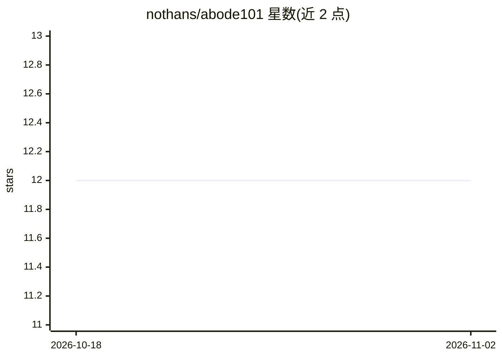

# nothans/abode101

⭐ 12 · Python · MIT · 推送 2026-09-07 · [GitHub](https://github.com/nothans/abode101) · [官网](https://nothans.com/abode-101-a-practical-project-to-learn-the-open-knowledge-format-okf) · 个人维护

**AI 维护的家庭知识库框架：Markdown 文件夹+代理契约**

基于 Google OKF / Karpathy 'LLM wiki' 模式的家庭知识库脚手架：一个 Markdown 文件夹（每文件一个概念、YAML frontmatter 含信任字段），配 AGENTS.md 代理契约与 capture/ingest/夜间调研/提醒 playbook。用户将任意 LLM/agent（如 Claude Code、Codex、Gemini CLI、Cursor）指向该文件夹，即可录入与查询家庭物品信息，回答需带出处、不知则拒答。真实房屋数据通过 gitignore 排除，仓库仅提供可复用的结构、契约与工具（PDF 提取/OCR、元数据读取）。

## 筛选速览

| 维度 | 判定 | 备注 |
|---|---|---|
| AI 角色 | `ai-ecosystem` | LLM/agent 周边工具 |
| 许可风险 | `permissive` | MIT |
| 部署形态 | `None` |  |
| 模型依赖 | — | README 未给出锁定关系 |
| 硬件要求 | — | 无带数字的原话,不猜 |
| 安装摩擦 | `low` | 无编译、无系统依赖或容器化 |
| 成熟度 | — | 结构信号不足 |

## 能力要点

- 符合 OKF v0.2 规范（信任字段：sources/generated/verified/status/stale_after）
- playbooks 提供 capture/ingest/夜间网络调研重校验/提醒的维护循环
- AGENTS.md 定义逐事实溯源（值+置信度+引文出处），要求带引用回答且拒猜
- 附带 pdf-text/pdf-ocr/artifact-meta 工具与 evals 评测用例

## 适用场景

- 记录家中物品、说明书、维修与保养计划并用对话查询
- 让 agent 夜间自动调研新购入物品并重校验过期条目
- Fork 后建立自己的家庭知识库脚手架

## 场景标签

`知识库管理` · 领域:知识与检索

## 证据(README 行号)

> L16: It's the **Open Knowledge Format** (Google's OKF /
> L36: Point any LLM/agent at the folder (it reads `AGENTS.md` + `index.md` first), then ask:
> L98: 4. Point your LLM at `AGENTS.md` and ask it to capture / ingest. Claude Code,

## 星数曲线

2026-10-18 12 → 2026-11-02 12（+0）

---
*卡片 v1 · prompt 1.4 · 生成 2026-11-01 · 置信度 high · 依据 README sha `bd874aa687ec` · [字段定义](../../DATASET.md)*
