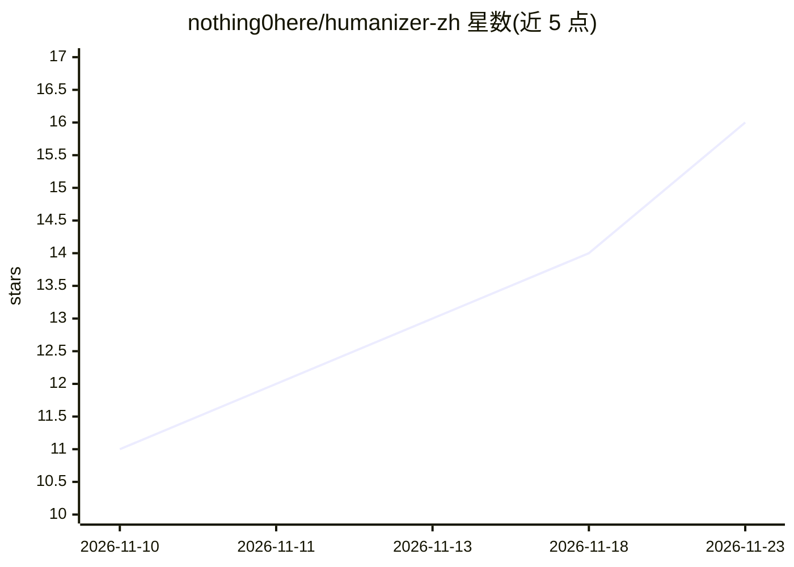

# nothing0here/humanizer-zh

⭐ 16 · MIT · 推送 2026-08-31 · [GitHub](https://github.com/nothing0here/humanizer-zh) · 个人维护 · 中文 README

**去除中文文本“AI味”的 Agent 技能（SKILL.md 提示词规范）**

面向中文场景的 Agent Skill：以单个 SKILL.md 提示词规范形式提供，指导大模型将带“AI味”的中文文本（大词黑话、翻译腔、格式八股、鸡汤结尾等）重写为自然人类语言。基于维基百科 Signs of AI writing 项目重构扩充，声明去味不改意、严禁脑补、支持传入个人写作样本拟合声调、处理文档时保护代码块与 YAML 元数据。提供自媒体、职场公文、技术文档、日常沟通四类场景规范，通过 npx skills CLI 或手动下载 SKILL.md 安装到 Claude Code、Codex、Gemini CLI、Cursor 等宿主中使用。

## 筛选速览

| 维度 | 判定 | 备注 |
|---|---|---|
| AI 角色 | `ai-ecosystem` | LLM/agent 周边工具 |
| 许可风险 | `permissive` | MIT |
| 部署形态 | `library` | 以包/库形式分发 |
| 模型依赖 | — | README 未给出锁定关系 |
| 硬件要求 | — | 无带数字的原话,不猜 |
| 安装摩擦 | `low` | 无编译、无系统依赖或容器化 |
| 成熟度 | — | 结构信号不足 |

## 能力要点

- 单个 SKILL.md 提示词规范，适配多种 AI 编程助手与 Agent 宿主
- 声调拟合：支持传入个人写作样本模仿原有句式与语气
- 文件级安全：处理 Markdown 时保护代码块、Frontmatter、内联代码与链接
- 四类中文场景（自媒体/职场公文/技术文档/日常沟通）定制改写规范

## 适用场景

- 把公众号、专栏里带机器腔的 AI 生成文稿改写成自然表达
- 让 AI 按我自己的写作习惯输出内容
- 在 Claude Code / Codex 等助手中就地润色项目文档

## 场景标签

`提示工程` `AI 写作` · 领域:Agent 开发

## 证据(README 行号)

> L34: npx skills add nothing0here/humanizer-zh --global
> L64: #### 🔹 Cursor / Windsurf / Roo Code / Cline
> L20: **Humanizer-ZH** 基于维基百科 Signs of AI writing 项目，针对**国内中文语言习惯、互联网/职场语境、中文自媒体生态及欧化翻译腔**进行了全面重构与扩充。

## 星数曲线

2026-11-10 11 → 2026-11-23 16（+5）

---
*卡片 v1 · prompt 1.4 · 生成 2026-11-18 · 置信度 mid · 依据 README sha `bb330bc412dc` · [字段定义](../../DATASET.md)*
