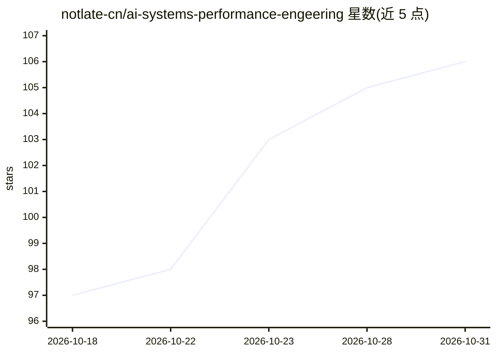

# notlate-cn/ai-systems-performance-engeering

⭐ 106 · 推送 2026-07-24 · [GitHub](https://github.com/notlate-cn/ai-systems-performance-engeering) · [官网](https://aispe.notlate.cn) · 个人维护 · 中文 README

**AI 系统性能工程一书的中英对照翻译阅读站**

对 Chris Fregly 所著《AI Systems Performance Engineering》（O'Reilly）的 20 章内容做中英对照翻译，覆盖 GPU 架构、CUDA 调优、分布式训练、大规模推理等主题。以 MkDocs + Material 主题构建静态站点，托管于 GitHub Pages，提供全文搜索、深色模式、文本标注（需登录 GitHub）与响应式布局。翻译由 GLM5 完成、人工校对，作者自述初稿仍有格式与译 accuracy 问题。原书版权归 O'Reilly，本项目 CC BY-NC-SA 4.0，禁止商用。

## 筛选速览

| 维度 | 判定 | 备注 |
|---|---|---|
| AI 角色 | `ai-knowledge` | 知识聚合/清单类 |
| 许可风险 | `none` | — |
| 部署形态 | `None` |  |
| 模型依赖 | — | README 未给出锁定关系 |
| 硬件要求 | — | 无带数字的原话,不猜 |
| 安装摩擦 | `low` | 无编译、无系统依赖或容器化 |
| 成熟度 | `idea` | |

## 能力要点

- 20 个章节的中英对照翻译
- MkDocs 静态站点 + 全文搜索/深色模式/文本标注
- GLM5 机翻 + 人工校对流程
- GitHub Actions 自动部署，本地可克隆构建

## 适用场景

- 中英对照阅读学习 AI 系统性能工程内容
- 查阅 GPU/CUDA/推理优化的章节资料
- 参与改进翻译或报告问题

## 场景标签

`教程课程` · 领域:学习与行业

## 证据(README 行号)

> L6: > **AI Systems Performance Engineering (Chris Fregly)** 中英对照翻译项目
> L26: - **📖 中英对照**: 每个段落同时展示英文原文和中文翻译，便于对照学习

## 星数曲线

2026-10-18 97 → 2026-10-31 106（+9）

---
*卡片 v1 · prompt 1.4 · 生成 2026-10-23 · 置信度 high · 依据 README sha `ba4d9bba4e8e` · [字段定义](../../DATASET.md)*
