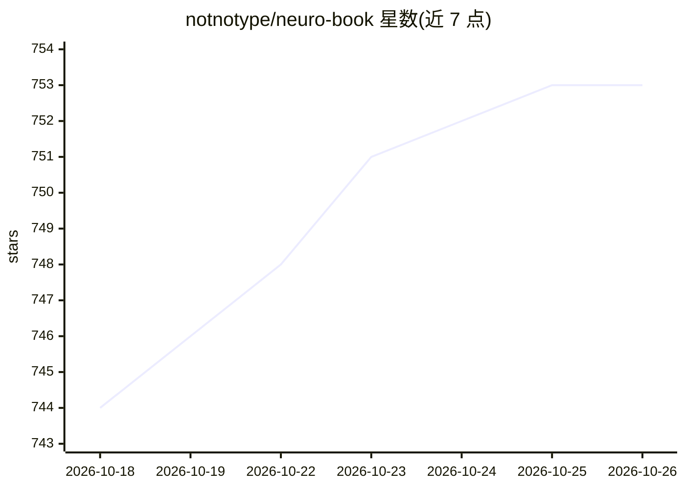

# notnotype/neuro-book

⭐ 753 · TypeScript · AGPL-3.0 · 推送 2026-10-24 · [GitHub](https://github.com/notnotype/neuro-book) · [官网](https://blog.notnotype.com/neuro-book/official/) · 个人维护 · 中文 README

**面向长篇小说写作的 AI IDE，用工程方法管设定、伏笔与成稿**

面向长篇小说作者的本地写作应用：左侧世界书文件树、中间正文编辑器、右侧 AI 写作助手。核心机制包括 World Engine（基于时间线+切面的事件溯源式世界状态推算，可审计）、Plot Workbench（伏笔承诺账本、创作决策记录、章节信息控制）、多 Agent 写作工作室（leader/writer/researcher 分工，讨论/计划/执行三模式需人工审批）与 llmlint（360 条规则检测 AI 写作痕迹）。数据为本地 Markdown 与 SQLite，多 Provider API Key 自选，支持 SillyTavern 角色卡迁移。当前处于快速开发阶段，v2 分支重建中。

## 筛选速览

| 维度 | 判定 | 备注 |
|---|---|---|
| AI 角色 | `ai-native` | 本体是模型或模型工具 |
| 许可风险 | `viral` | AGPL-3.0 |
| 部署形态 | `None` |  |
| 模型依赖 | — | README 未给出锁定关系 |
| 硬件要求 | — | 无带数字的原话,不猜 |
| 安装摩擦 | `low` | 无编译、无系统依赖或容器化 |
| 成熟度 | `idea` | |

## 能力要点

- World Engine 事件溯源式世界状态推算，任意时刻状态可查可审计
- 伏笔承诺账本与创作决策记录（ADR 式留痕）
- 多 Agent 分工写作，三模式均需人工审批，保留创作主导权
- llmlint 360 条规则检测 AI 写作痕迹，另有独立 CLI

## 适用场景

- 长篇连载中追踪设定与世界状态，避免吃书
- 登记伏笔并按剧情推进获得兑现提醒
- 让 AI Agent 在权限内协助查资料、写正文、润色稿件

## 场景标签

`AI 写作` `多智能体` · 领域:Agent 开发

## 证据(README 行号)

> L25: 每个人心里都有一部长篇，但绝大多数死在半路——不是死于没天赋，是死于没有工程。NeuroBook 把软件工程三十年的实践和创意写作一百年的方法论，做成你和 AI 共用的同一套工具：世界状态由引擎推算而不是靠模型记忆，伏笔像技术债一
> L99: AI 已经是一匹好马，NeuroBook 是那副鞍（NeuroAgentHarness——Harness 本义就是马具），缰绳在你手里。目前的 AI 没有独立写完一本优质小说的能力，但它最擅长的恰恰是：整理资料、查证细节、陪你头脑
> L101: - 各司其职：leader 规划剧情与调度，writer 专职正文，retrieval / researcher 查设定查资料——数值不乱编（引擎账上有），资料不瞎猜（researcher 去查）。

## 星数曲线

2026-10-18 744 → 2026-10-26 753（+9）

---
*卡片 v1 · prompt 1.4 · 生成 2026-10-21 · 置信度 high · 依据 README sha `e48e82ef92d4` · [字段定义](../../DATASET.md)*
