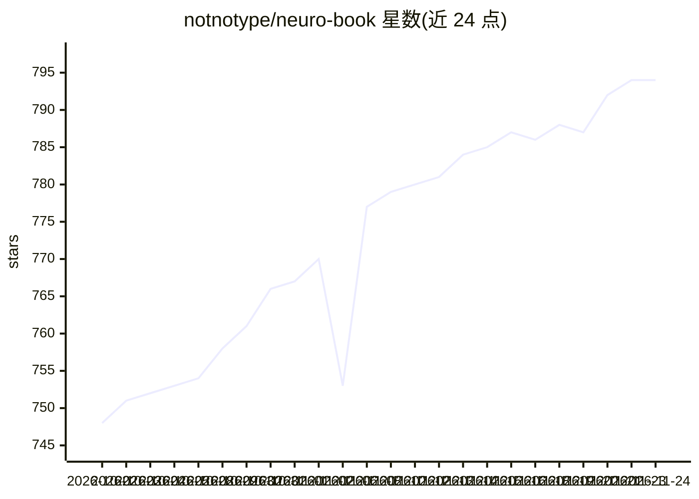

# notnotype/neuro-book

⭐ 794 · TypeScript · AGPL-3.0 · 推送 2026-11-20 · [GitHub](https://github.com/notnotype/neuro-book) · [官网](https://blog.notnotype.com/neuro-book/official/) · 个人维护 · 中文 README

**面向长篇小说作者的 AI 协作写作 IDE**

NeuroBook 把软件工程的工作台形态用于长篇创作：本地 Markdown 文件为作品载体，提供书架、可拖拽布局的工作台、三类文件夹管理、按中文排版方言读写的编辑器与插件系统（TypeScript/Vue SDK，`nbook plugin install` 安装）。路线图显示 AI 写作、世界引擎、剧情工坊将逐步搬入 v2；当前发布的是工作台底座（v0.11 预览版），仓库另含 nb-harness、nb-profile 等 Agent 相关包。仅支持 Bun 运行。

## 筛选速览

| 维度 | 判定 | 备注 |
|---|---|---|
| AI 角色 | `ai-native` | 本体是模型或模型工具 |
| 许可风险 | `viral` | AGPL-3.0 |
| 部署形态 | `None` |  |
| 模型依赖 | — | README 未给出锁定关系 |
| 硬件要求 | — | 无带数字的原话,不猜 |
| 安装摩擦 | `low` | 无编译、无系统依赖或容器化 |
| 成熟度 | `idea` | |

## 能力要点

- 作品以本地 Markdown 存储，外部修改即时同步
- 工作台布局可拖拽记忆，带命令面板与快速打开
- 插件用 TypeScript 与 Vue 编写，内置功能同为插件实现
- 仓库包含 Agent harness、Profile、会话日志等 AI 相关包

## 适用场景

- 在本地管理长篇小说的章节、设定与活页材料
- 用插件扩展写作工作台的视图与命令
- 通过命令行查看剧情图谱并与外部 Agent 配合

## 场景标签

`AI 写作` · 领域:内容生成

## 证据(README 行号)

> L16: 每个人心里都有一部长篇，但绝大多数死在半路——不是死于没天赋，是死于没有工程。NeuroBook 想把软件工程三十年的实践和创意写作一百年的方法论，做成你和 AI 共用的同一套工具。你的作品是本地的 Markdown 文件，随时带
> L19: > **现在是 v2 预览版（0.11）。** NeuroBook 正在按 NeuroBook v2：并排重建应用 从零重建：先把工作台、文件与编辑器、设置和插件这层底座做扎实，再把 AI 写作、世界引擎、剧情工坊一项项搬上来（见
> L72: |`@notnotype/nb-story`|剧情图谱：`nbstory` 命令行、本机网页查看器与问答、外部 Agent 的 Skill|

## 星数曲线

2026-10-22 748 → 2026-11-24 794（+46）

---
*卡片 v1 · prompt 1.4 · 生成 2026-11-24 · 置信度 mid · 依据 README sha `b4ef9b2e4535` · [字段定义](../../DATASET.md)*
