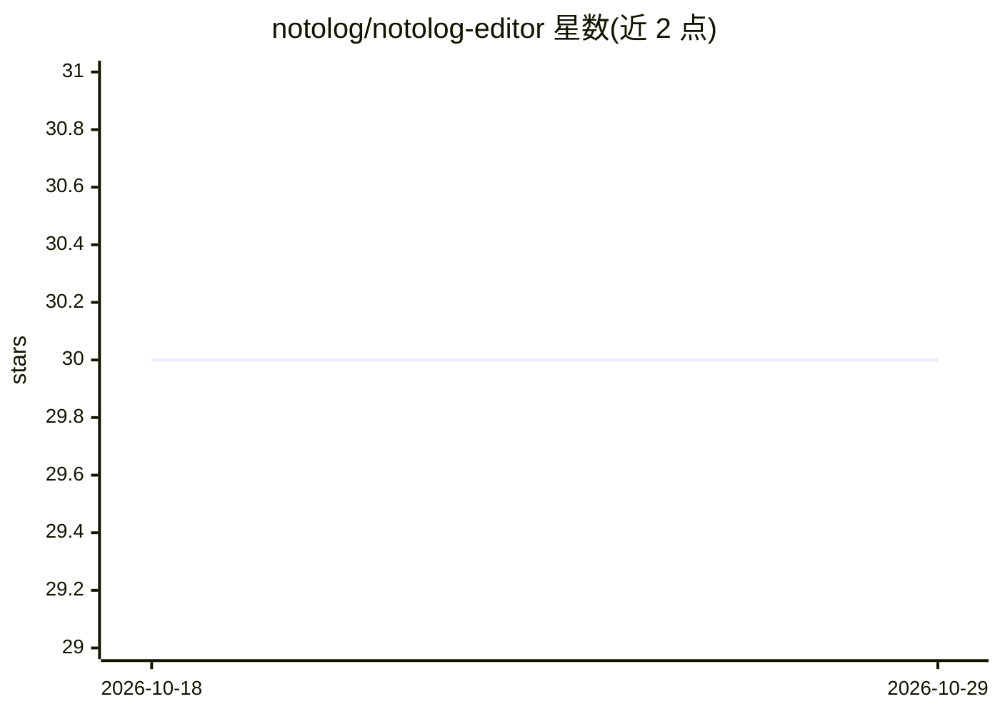

# notolog/notolog-editor

⭐ 30 · Python · MIT · 推送 2026-09-07 · [GitHub](https://github.com/notolog/notolog-editor) · [官网](https://notolog.app) · 个人维护

**带本地 AI 助手与 TTS 的 Markdown 编辑器，隐私本地优先**

基于 Python 和 PySide6 的开源 Markdown 编辑器，提供实时语法高亮、实时预览、行号与代码块编辑功能。AI 能力作为其中功能：支持 OpenAI API、ONNX Runtime GenAI 与 llama.cpp（GGUF 模型）三种后端，均可本地推理；另含基于 NeMo-Speech.cpp 和 MagpieTTS 的本地文本转语音朗读、PBKDF2HMAC+Fernet 可选文件加密、19 种语言与 6 套主题，跨 Windows/macOS/Linux。通过 pip、conda、Debian 包或源码安装。

## 筛选速览

| 维度 | 判定 | 备注 |
|---|---|---|
| AI 角色 | `ai-enhanced` | 去掉 AI 部分产品仍成立 |
| 许可风险 | `permissive` | MIT |
| 部署形态 | `library` | 以包/库形式分发 |
| 模型依赖 | local-ok | 支持本地模型 |
| 硬件要求 | — | 无带数字的原话,不猜 |
| 安装摩擦 | `low` | 无编译、无系统依赖或容器化 |
| 成熟度 | — | 结构信号不足 |

## 能力要点

- 三种 AI 后端：OpenAI API、ONNX Runtime GenAI、llama.cpp（GGUF）
- NeMo-Speech.cpp 与 MagpieTTS 本地文本转语音朗读
- PBKDF2HMAC 密钥派生 + Fernet (AES-128 CBC) 可选文件加密
- 19 种语言、6 套主题、跨三平台

## 适用场景

- 写作与编辑 Markdown 文档并获得 AI 辅助
- 在离线/无遥测环境下用本地模型做 AI 助手与语音朗读
- 加密保存敏感笔记文档

## 场景标签

`AI 助手` `语音合成` · 领域:对话与助手

## 证据(README 行号)

> L7: Notolog is an open-source Markdown editor built with Python and PySide6, featuring AI-powered assistance and local-f
> L51: - **AI Assistant** - Supports: OpenAI API, ONNX Runtime GenAI (local), and llama.cpp (local, GGUF models)

## 星数曲线

2026-10-18 30 → 2026-10-29 30（+0）

---
*卡片 v1 · prompt 1.4 · 生成 2026-10-26 · 置信度 high · 依据 README sha `0caed51aa353` · [字段定义](../../DATASET.md)*
