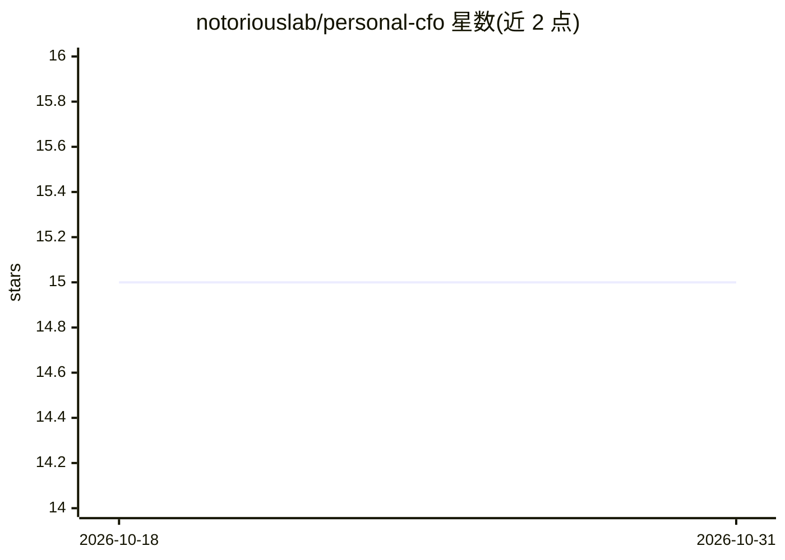

# notoriouslab/personal-cfo

⭐ 15 · Python · MIT · 推送 2026-04-02 · [GitHub](https://github.com/notoriouslab/personal-cfo) · 组织维护 · 中文 README

**给非专业投资人的本地确定性退休轨道监控工具**

Python CLI 参考实现：读取银行账单（CSV / Markdown+JSON / 手写 pipe table），用确定性运算（零 AI 猜测）产出月度损益表、按风险桶分类的资产负债表、现金流量摘要与退休滑行路径诊断；project 子命令基于通胀、报酬率、年金假设做逐年退休投影与 4%/3.5% Rule 校验。多币种静态汇率、离线模式、原子写入，数据不上传。需 Python 3.9+，用户需懂 CLI 并自行在 config.yaml 中设定分类规则与退休参数；附 SKILL.md 供 OpenClaw 等 AI agent 框架通过 shell 调用。

## 筛选速览

| 维度 | 判定 | 备注 |
|---|---|---|
| AI 角色 | `ai-enhanced` | 去掉 AI 部分产品仍成立 |
| 许可风险 | `permissive` | MIT |
| 部署形态 | `None` |  |
| 模型依赖 | — | README 未给出锁定关系 |
| 硬件要求 | — | 无带数字的原话,不猜 |
| 安装摩擦 | `low` | 无编译、无系统依赖或容器化 |
| 成熟度 | — | 结构信号不足 |

## 能力要点

- 银行账单进、财务报表出，全部运算在本地完成
- cfo/track/project 三个子命令：月度审计、轨道追踪、退休投影
- 随年龄自动降股的 glide path，偏离时才提醒
- 任何 AI agent 框架可通过 shell 调用，附 SKILL.md

## 适用场景

- 每月用银行账单生成损益表与资产负债表做财务体检
- 追踪退休计划是否在轨，偏离 glide path 时收到提醒
- 按自身情况调整参数后推算退休金是否够用

## 场景标签

 · 领域:个人财务/退休规划

## 证据(README 行号)

> L11: 任何 AI agent 框架都可以透過 shell 呼叫，附帶 `SKILL.md` 讓 OpenClaw 直接整合使用。
> L27: |確定性運算|Python 算數字，零幻覺，不靠 AI 猜|
> L202: 附帶 `SKILL.md` 讓 OpenClaw 或其他 AI agent 框架直接整合。

## 星数曲线

2026-10-18 15 → 2026-10-31 15（+0）

---
*卡片 v1 · prompt 1.4 · 生成 2026-10-30 · 置信度 high · 依据 README sha `c1f5a617b956` · [字段定义](../../DATASET.md)*
