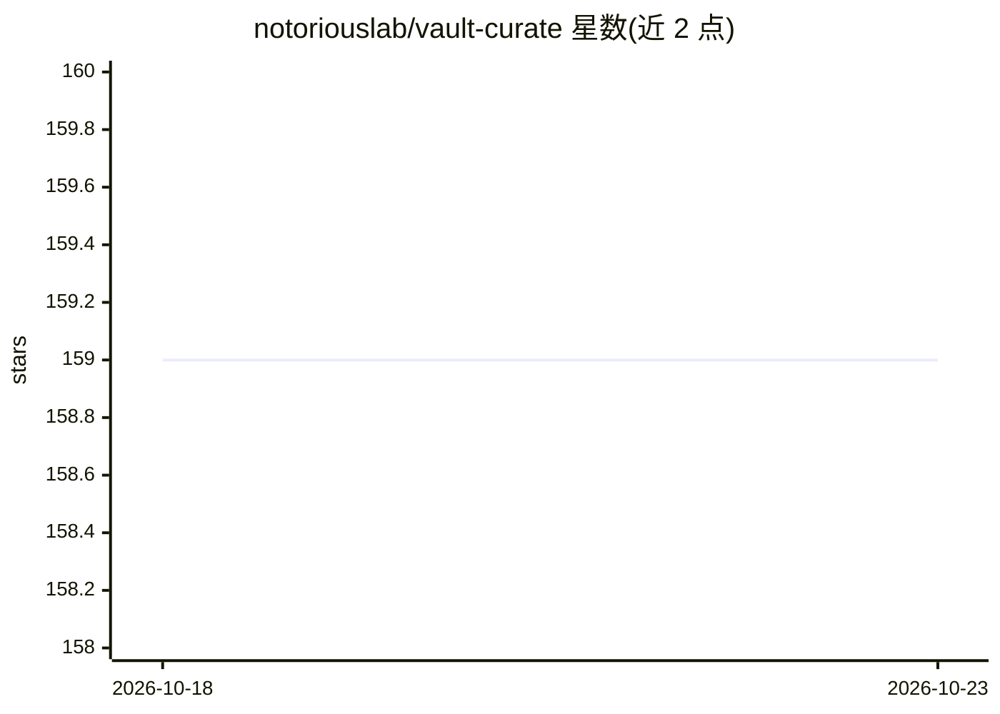

# notoriouslab/vault-curate

⭐ 159 · TypeScript · MIT · 推送 2026-10-21 · [GitHub](https://github.com/notoriouslab/vault-curate) · [官网](https://community.obsidian.md/plugins/vault-curate) · 个人维护 · 中文 README

**Obsidian 笔记的本地语义搜索与关联发现插件**

面向 Obsidian 用户的本地优先知识管理插件：内置约 110MB 中文/CJK 优化模型，提供关键词+语义+模糊标题三路合并搜索、Canvas 关系图与语义路径、基于链接与近期编辑的 Hot/Cold 分层再发现；可选 AI 整理（生成描述、标签、MOC）。桌面端构建索引，移动端经 iCloud/Syncthing 同步后直接检索，无需重新索引；默认不出网、无需 API key，可切换 Ollama 或任意 OpenAI 兼容服务做整理。所有连接均为建议，用户逐条裁决。

## 筛选速览

| 维度 | 判定 | 备注 |
|---|---|---|
| AI 角色 | `ai-native` | 本体是模型或模型工具 |
| 许可风险 | `permissive` | MIT |
| 部署形态 | `library` | 以包/库形式分发 |
| 模型依赖 | local-ok | 支持本地模型 |
| 硬件要求 | — | 无带数字的原话,不猜 |
| 安装摩擦 | `low` | 无编译、无系统依赖或容器化 |
| 成熟度 | — | 结构信号不足 |

## 能力要点

- 内置中文/CJK 优化模型（约 110MB），无需 API key，默认不出网
- 关键词+语义+模糊标题三路搜索合并排序，长文最多读入 6 万字符
- Canvas 关系图、语义路径与就地扩展，紫色边标注未链接的语义近邻
- 桌面建索引、移动端直接检索，无需重建索引或下载模型

## 适用场景

- 只记得大意想不起确切关键词时找到旧笔记
- 发现从未手动链接的相关笔记并一键转为 wikilink
- 按 Hot/Cold 分层重新翻出久未触碰的冷笔记
- 让本地 LLM 批量生成笔记描述、标签与主题目录（MOC）

## 场景标签

`知识库管理` `语义搜索` · 领域:知识与检索

## 证据(README 行号)

> L14: Semantic search and connection-finding for your Obsidian notes, strong on Chinese/CJK · semantic search · relation 
> L33: - **Nothing leaves your machine by default.** Everything runs on your own computer: the model is about 110 MB and d
> L42: 1. **Find**: semantic search that finds notes even when you phrase it differently, and shows the passage that match

## 星数曲线

2026-10-18 159 → 2026-10-23 159（+0）

---
*卡片 v1 · prompt 1.4 · 生成 2026-10-22 · 置信度 high · 依据 README sha `5f1c656dafea` · [字段定义](../../DATASET.md)*
