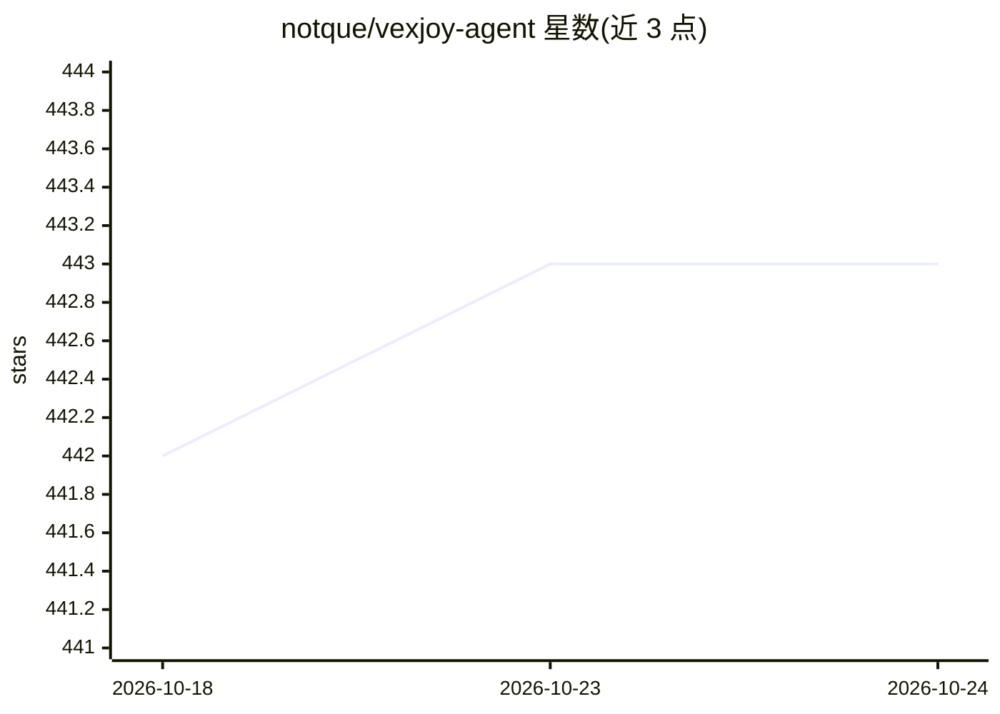

# notque/vexjoy-agent

⭐ 443 · Python · MIT · 推送 2026-10-24 · [GitHub](https://github.com/notque/vexjoy-agent) · [官网](https://vexjoy.com) · 个人维护

**面向多 AI 编码运行时的 agent/技能/工作流工具箱与路由器**

VexJoy Agent 是一套可安装进 Claude Code、Codex、Factory、Reasonix 等编码 CLI 的工具箱，含 43 个领域 agent、62 个技能、79 个 hooks、156 个脚本。核心入口 /do 用自然语言请求选择 agent、技能与工作流；可选的 /d 路由器依赖 TypeSafe 的 Jev 做意图分类与意图保持校验（经 Vercel AI Gateway 或直连 API）。Hooks 在生命周期事件上强制证据检查（测试输出、退出码），并有内容引擎支持写作类任务。通过 git clone 加 install.sh 安装，MIT 许可。

## 筛选速览

| 维度 | 判定 | 备注 |
|---|---|---|
| AI 角色 | `ai-ecosystem` | LLM/agent 周边工具 |
| 许可风险 | `permissive` | MIT |
| 部署形态 | `None` |  |
| 模型依赖 | locked-api |  |
| 硬件要求 | — | 无带数字的原话,不猜 |
| 安装摩擦 | `low` | 无编译、无系统依赖或容器化 |
| 成熟度 | — | 结构信号不足 |

## 能力要点

- /do 将自然语言请求路由到 agent+技能组合
- Jev 驱动的 /d 路由器：意图保持校验与分发回执，学习数据写入 learning.db
- Hooks 强制证据型检查：退出码/测试输出而非模型自述
- 一套工具箱安装到 Claude Code/Codex/Factory/Reasonix 四种运行时

## 适用场景

- 在 Claude Code 等编码 CLI 中用一句话分派任务给合适的 agent
- 通过 hooks 强制测试与验证通过后才允许交付
- 写作、研究、数据分析等知识工作流
- 用脚本做定时调度与维护审计

## 场景标签

`编码 Agent` `Agent 框架` · 领域:Agent 开发

## 证据(README 行号)

> L7: VexJoy Agent connects plain-English requests to specialist agents, skills, and workflows. `/do` selects the knowledg
> L13: Works across Claude Code (`/do`), Codex (`$do`), Factory (`/do`), Reasonix (`/do`).
> L110: Installs into `~/.claude/` and into `~/.codex/`, `~/.factory/`, `~/.hermes/`, and `~/.reasonix/` when the runtime 

## 星数曲线

2026-10-18 442 → 2026-10-24 443（+1）

---
*卡片 v1 · prompt 1.4 · 生成 2026-10-21 · 置信度 high · 依据 README sha `9d4f0574ad94` · [字段定义](../../DATASET.md)*
