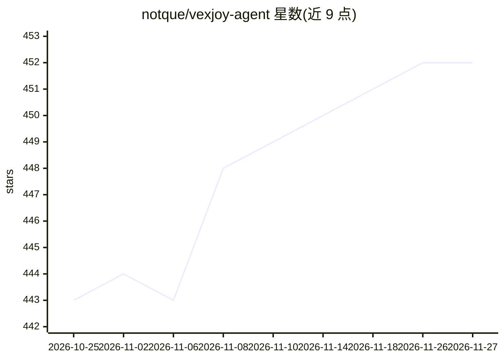

# notque/vexjoy-agent

⭐ 452 · Python · MIT · 推送 2026-11-26 · [GitHub](https://github.com/notque/vexjoy-agent) · [官网](https://vexjoy.com) · 个人维护

**为编码 CLI 智能体提供技能/流水线/钩子的工具集**

将自然语言请求接入 46 个技能、26 条流水线、71 个钩子与 168 个脚本：`/do` 路由器为任务选择所需知识与工具，钩子在提交、推送、合并等动作上强制证据检查（测试输出、CI 通过），并记录路由结果形成学习循环。安装到 ~/.claude/ 等多个运行时目录，需 Python 3.10+、git、bash；安装会修改 ~/.claude/settings.json 与 ~/.bashrc，提供 --dry-run、--uninstall 等选项。`/d` 路由依赖 TypeSafe Jev 做意图对齐判定，无该配置时回退到 `/do`。

## 筛选速览

| 维度 | 判定 | 备注 |
|---|---|---|
| AI 角色 | `ai-ecosystem` | LLM/agent 周边工具 |
| 许可风险 | `permissive` | MIT |
| 部署形态 | `library` | 以包/库形式分发 |
| 模型依赖 | — | README 未给出锁定关系 |
| 硬件要求 | — | 无带数字的原话,不猜 |
| 安装摩擦 | `low` | 无编译、无系统依赖或容器化 |
| 成熟度 | — | 结构信号不足 |

## 能力要点

- 46 技能 / 26 流水线 / 71 钩子 / 168 脚本的分层结构
- /d 路由经 Jev 意图对齐判定并生成凭据后分发
- 钩子拦截 main/master 提交、未过 CI 的合并等动作
- 一套安装同时镜像到 Claude Code、Codex、Factory、Reasonix、Antigravity、Cline

## 适用场景

- 在 Claude Code 中用自然语言触发带检查门的调试/开发流程
- 为多个编码 CLI 统一安装同一套技能与钩子配置
- 用钩子阻止未经测试或未过 CI 的提交与合并

## 场景标签

`编码 Agent` · 领域:编码与开发

## 证据(README 行号)

> L7: VexJoy Agent connects plain-English requests to skills and workflows. `/do` selects the knowledge and tools needed f
> L11: 46 skills, 26 pipelines, 71 hooks, 168 scripts. Skills carry domain knowledge and reusable methods, pipelines hold 

## 星数曲线

2026-10-25 443 → 2026-11-27 452（+9）

---
*卡片 v1 · prompt 1.4 · 生成 2026-11-25 · 置信度 mid · 依据 README sha `b30738d6c1d1` · [字段定义](../../DATASET.md)*
