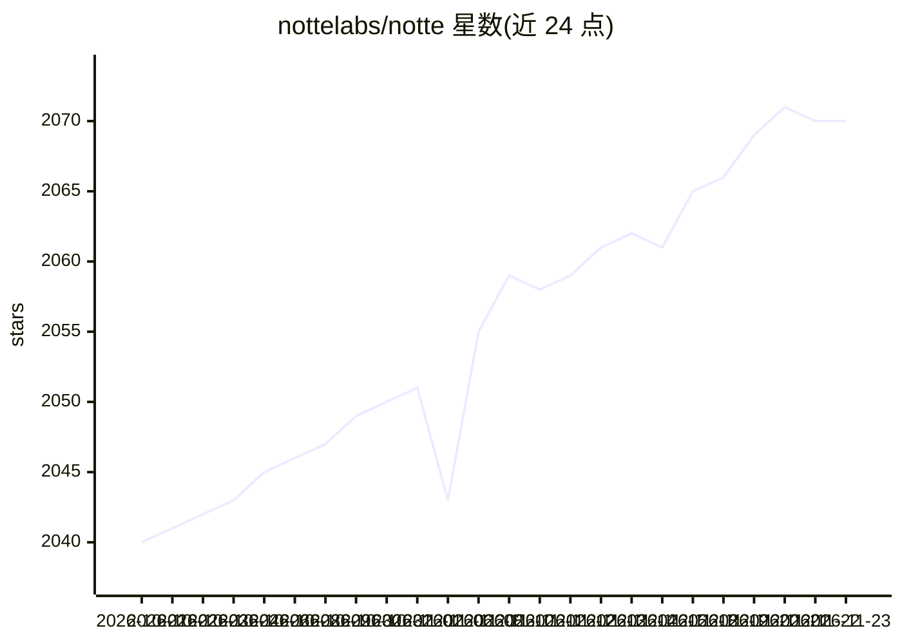

# nottelabs/notte

⭐ 2,070 · Python · NOASSERTION · 推送 2026-11-22 · [GitHub](https://github.com/nottelabs/notte) · [官网](https://console.notte.cc) · 组织维护

**为 AI agent 与脚本提供云端隐身浏览器的基础设施**

Notte 提供 Playwright 驱动的浏览器基础设施：本地浏览器会话将页面转为可执行动作观察与 markdown；云端会话内置隐身、验证码求解、代理与反检测，通过 CDP 供 Playwright/Puppeteer/Selenium 接入。还提供函数部署（Python 自动化作为 API/定时任务）、凭证保险库、数字身份（邮箱/电话/2FA）与结构化抓取端点。核心用 Python 3.11+ 库发布，另有 Node SDK、CLI 与 MCP 服务器；1.10 起移除了内置 agent loop 与本地函数执行。

## 筛选速览

| 维度 | 判定 | 备注 |
|---|---|---|
| AI 角色 | `ai-ecosystem` | LLM/agent 周边工具 |
| 许可风险 | `viral` | NOASSERTION |
| 部署形态 | `library` | 以包/库形式分发 |
| 模型依赖 | local-ok | 支持本地模型 |
| 硬件要求 | — | 无带数字的原话,不猜 |
| 安装摩擦 | `low` | 无编译、无系统依赖或容器化 |
| 成熟度 | — | 结构信号不足 |

## 能力要点

- 本地/云端浏览器会话共用同一 API，云端内置隐身与 CAPTCHA 求解
- Everything over CDP：现有 Playwright/Puppeteer 代码可直接接入云会话
- 凭证保险库与数字身份，代码中只见占位符
- 自动化部署为函数：按需、定时或 API 端点运行

## 适用场景

- 给编码 agent 接一个云端隐身浏览器
- 部署网页自动化脚本为定时任务或 API
- 对登录墙后的页面做结构化数据抽取
- 管理自动化所需的凭证与数字身份

## 场景标签

`浏览器自动化` `网页抓取` `工作流自动化` · 领域:效率与自动化

## 证据(README 行号)

> L1: # Browser infrastructure for AI agents and web automation
> L17: Notte gives AI agents and scripts a reliable browser. Drive cloud browser sessions with built-in stealth, CAPTCHA s
> L35: - **Stealth browser sessions** → Hosted browsers with CAPTCHA solving, proxies and anti-detection, reachable over C

## 星数曲线

2026-10-21 2,040 → 2026-11-23 2,070（+30）

---
*卡片 v1 · prompt 1.4 · 生成 2026-11-23 · 置信度 high · 依据 README sha `af492918cebb` · [字段定义](../../DATASET.md)*
